# CortexIDE

**本机优先的 Agent IDE · 持久向量记忆**  
产品名 Cortex · 实现 **v0.6.4** · React 19 + Vite + Electron

[](https://github.com/skyline019/CortexIDE/actions/workflows/ci.yml)
[](https://github.com/skyline019/CortexIDE/releases/latest)
[](LICENSE)
[](package.json)

CortexIDE 把**真实磁盘工作区**、**多会话 Agent**、**终端**与**分区向量记忆**收进同一桌面应用；模型走 OpenAI 兼容接口（含 DeepSeek）。面向个人本机使用，不是云端协作 IDE。

| | |
|:---|:---|
| **公开版本** | [v0.6.4](https://github.com/skyline019/CortexIDE/releases/tag/v0.6.4) |
| **桌面产物** | `Cortex-0.6.4-Setup.exe`（安装包）· `Cortex-0.6.4-Portable.exe`（便携） |
| **质量门禁** | [Strict CI](https://github.com/skyline019/CortexIDE/actions)：Lint → Hygiene → Test → Build → Smoke mock → **OK** |
| **本机发布门** | `npm test` **180** · `lint` **0** · `smoke:mock` / `smoke:key` / `smoke:exe`（硬断言） |
| **许可** | [MIT](LICENSE) |

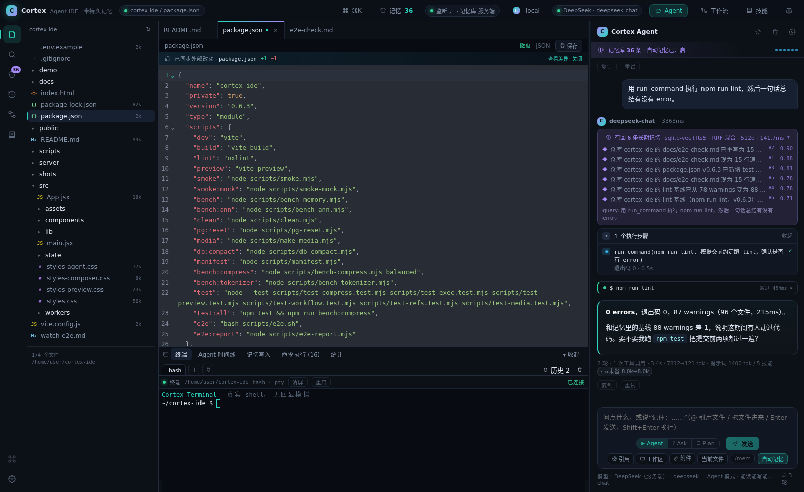

---

## 目录

1. [定位与适用范围](#1-定位与适用范围)
2. [体系结构概要](#2-体系结构概要)
3. [功能范围](#3-功能范围)
4. [下载桌面版](#4-下载桌面版)
5. [构建与快速开始](#5-构建与快速开始)
6. [质量门禁](#6-质量门禁)
7. [文档与导航](#7-文档与导航)
8. [许可与协作](#8-许可与协作)

---

## 1. 定位与适用范围

| | 说明 |
|:---|:---|
| **形态** | Windows 桌面（Electron）或本机浏览器（`npm run dev`） |
| **工作区** | 真实本地目录；多标签编辑 · 文件监听 · 外部 diff |
| **Agent** | Ask / Plan / Agent 三模式；工具读盘 / 写盘 / 白名单命令 |
| **记忆** | 浏览器嵌入 + 服务端 KNN（sqlite-vec，可选 PGlite/pgvector） |
| **非目标** | 云端多租户 IDE；SSH **透明挂载**；PPT **版式还原** |

> **边界：** PPT 为文本抽取预览；SSH 为探活 / 列目录 / 读写 / 增量同步，**不做 sshfs 式挂载**。密钥仅存本机 `.env` 或 `%APPDATA%\Cortex\`，勿提交仓库。

---

## 2. 体系结构概要

```text
Electron / 浏览器
 └── React UI          会话 · 编辑器 · 终端 · 预览 · Agent
      └── Vite 中间件   server/*（无独立框架）
           ├── fs / watch / exec / ssh / attach
           ├── llm-proxy · prompts · skills · workflow
           ├── memory-store（crud / search / ann / migrate）
           └── term-host（独立进程加载 node-pty）
```

| 主题 | 要点 |
|:---|:---|
| **会话** | `chatSessions` 唯一数据源；`messages` 为活动会话投影（schema v4） |
| **原生 ABI** | 开发默认 Node；桌面 / 打包切 Electron；错 ABI 探测在子进程 |
| **终端** | `node-pty` 仅在 `server/term-host.mjs`；宿主崩不拖死 Vite |
| **鉴权** | `CORTEX_AUTH_TOKEN(S)`；`/api/term` · `/api/watch` 的 WS upgrade 走 `checkAuth` |

现行架构与安全约定：[docs/ARCHITECTURE.md](docs/ARCHITECTURE.md) · 质量合同：[CONSTRAINTS.md](CONSTRAINTS.md)

---

## 3. 功能范围

| 类别 | 内容 |
|:---|:---|
| **编辑与预览** | CodeMirror 6；PDF / Word / Excel（SheetJS）/ PPT（文本）/ 媒体 |
| **Agent** | SSE function calling · 本地规则引擎 · 工作流 / Plan |
| **记忆** | 写入 / 检索 / 多用户隔离 · lexical 兜底 · ANN 粗筛（可选） |
| **执行** | 命令白名单 · 沙箱降级（有 Docker 则容器） |
| **远程** | SSH 同步与只读浏览（非挂载） |

---

## 4. 下载桌面版

从 [Releases · v0.6.4](https://github.com/skyline019/CortexIDE/releases/tag/v0.6.4) 下载：

| 文件 | 用途 |
|:---|:---|
| **Cortex-0.6.4-Setup.exe** | NSIS 安装包（可选目录、快捷方式） |
| **Cortex-0.6.4-Portable.exe** | 便携版（免安装） |

安装后数据目录：`%APPDATA%\Cortex\`（`.env`、记忆库）。默认工作区为「文档\Cortex」。

自行打包：

```bash
npm install
npm run dist:win     # → release/Cortex-*-Setup.exe + Portable.exe
npm run dist:dir     # → release/win-unpacked/Cortex.exe
```

国内若 Electron 下载失败：

```bat
set ELECTRON_MIRROR=https://npmmirror.com/mirrors/electron/
set ELECTRON_BUILDER_BINARIES_MIRROR=https://npmmirror.com/mirrors/electron-builder-binaries/
```

---

## 5. 构建与快速开始

**依赖：** Node.js ≥ 20、npm（桌面版另需本机可构建的 Electron 原生模块）

```bash
git clone git@github.com:skyline019/CortexIDE.git
cd CortexIDE
npm install
npm run desktop      # Electron：欢迎页选工作区 + API Key
# 或
npm run dev          # 浏览器 http://127.0.0.1:<port>
```

| 步骤 | 说明 |
|:---|:---|
| 1 | 欢迎页填 API Key（或设置中改模型 / Base URL），选择本机文件夹 |
| 2 | 顶栏应显示模型与记忆后端；侧栏为真实目录树；底部为终端 |
| 3 | `Ctrl+O` 欢迎页 · `Ctrl+1…9` 最近工作区 · `Ctrl+K` 命令面板 · `Ctrl+J` Agent |

最小 `.env`（完整模板见 [`.env.example`](.env.example)）：

```ini
DEEPSEEK_API_KEY=sk-...
LLM_BASE_URL=https://api.deepseek.com/v1
LLM_PROVIDER=deepseek
LLM_ALLOW_OVERRIDE=1
```

```bash
CORTEX_WORKSPACE=/path/to/your/project npm run dev
```

终端依赖使用 `@lydell/node-pty` 预编译包（npm 别名仍为 `node-pty`）。

---

## 6. 质量门禁

**Strict CI**（push / PR → `main`）：Lint（`--deny-warnings`）→ Hygiene → Full test → Vite build → `smoke:mock` → **Strict CI OK**。无 `continue-on-error`。

| 命令 | 作用 |
|:---|:---|
| `npm run lint` | oxlint `--deny-warnings` |
| `npm run ci:hygiene` | 备份 / 密钥跟踪 / 测试清单与下限 |
| `npm test` | 180 项 `node:test`（不联网） |
| `npm run build` | Vite production build |
| `npm run smoke:mock` | 无 Key 浏览器冒烟（需 `npm run dev`；CI 已自动化） |
| `npm run smoke:key` | 真 Key Agent 冒烟（发布机；**禁止**假 Key） |
| `npm run smoke:exe` | 已打包 `Cortex.exe` 冷启动（发布机） |

清单：[docs/SMOKE.md](docs/SMOKE.md) · 质量合同：[CONSTRAINTS.md](CONSTRAINTS.md)

---

## 7. 文档与导航

| 文档 | 内容 |
|:---|:---|
| [docs/INDEX.md](docs/INDEX.md) | 文档总索引 |
| [docs/ARCHITECTURE.md](docs/ARCHITECTURE.md) | 分层架构 · 预览边界 · ABI / term-host |
| [CONSTRAINTS.md](CONSTRAINTS.md) | 质量合同（硬门禁） |
| [CHANGELOG.md](CHANGELOG.md) | 版本变更 |
| [docs/SMOKE.md](docs/SMOKE.md) | 发布冒烟清单 |
| [docs/review-latest.md](docs/review-latest.md) | 审查快照（勿按旧稿返工） |
| [docs/manifest.md](docs/manifest.md) | 源码清单（`npm run manifest`） |

---

## 8. 许可与协作

以 [MIT License](LICENSE) 发布。

| | |
|:---|:---|
| Issues | https://github.com/skyline019/CortexIDE/issues |
| Releases | https://github.com/skyline019/CortexIDE/releases |

---

## 附录 · 能力细节与历史实测

> 以下为能力长文与历史实测数字；**产品口径与门禁以第 1–8 节为准**。若冲突，以 [docs/ARCHITECTURE.md](docs/ARCHITECTURE.md) 与 [CONSTRAINTS.md](CONSTRAINTS.md) 为准。

---

## 一、向量记忆：浏览器编码 + 服务端 KNN 双引擎

### 架构

```
                    ┌──────────── 前端（Web Worker）────────────┐
query ──► 嵌入模型 ─┤ bge-small-zh-v1.5 · q8 · 512 维           │──► 查询向量
                    └──────────────────────────────────────────┘
                                     │
                 ┌───────────────────┴────────────────────┐
                 ▼ ① 服务端 KNN（主路径）                  ▼ ② 浏览器内索引（兜底）
   /api/mem/search ─► sqlite-vec vec0 ─► 距离           VectorStore 余弦 ─► 候选集
                 └───────────────────┬────────────────────┘
                                     ▼
                     候选集内 min-max 归一化 ─► 混合打分 ─► topK 记忆
```

| 模块 | 位置 | 说明 |
| --- | --- | --- |
| 嵌入模型 | `src/workers/embedder.worker.js` | **bge-small-zh-v1.5**（q8，512 维，约 24MB），跑在 Web Worker 里，主线程不卡；首次从 HuggingFace 下载并缓存，之后离线可用 |
| 向量索引 | `src/lib/vector.js` | `Float32Array` 扁平存储 + L2 归一化，点积即余弦；支持增量 upsert / 删除 / 序列化 |
| 索引管理 | `src/lib/retrieval.js` | 内容哈希判断增量、分批编码、进度上报、持久化、查询缓存；**优先走服务端 KNN，返回为空才回落本地索引** |
| 服务端存储 | `server/pg-store.js`·`memory-store.js` | SQLite + `sqlite-vec` 分区 vec0 / Postgres + pgvector，见第四、五节 |
| 混合打分 | `src/lib/memory.js` | 见下 |
| 语义去重 | `src/lib/retrieval.js` | 新记忆落库后用向量做一次两两比对，余弦 > 0.88 视为同一条，合并并累加使用次数 |

### 打分公式

```
匹配度  = 候选集内 min-max 归一化的余弦相似度
得分    = 0.62·匹配度 + 0.18·重要度 + 0.12·新鲜度 + 0.08·频次
```

> 为什么归一化：bge 的中文余弦大多挤在 0.45~0.85，直接线性加权时「重要度 5 星的旧记忆」会盖过真正相关的那条。归一化后语义匹配才真正占主导。
> 实测：查询「代码合入前要做什么检查」→ 命中「提交前必须跑 pnpm lint 和 pnpm test」（**没有一个字面词重合**），得分 0.96，第一名。

### 兜底与可观测

- 神经模型加载失败/离线 → 自动回落到**本地哈希向量**（词 + 中文 bigram + 字符 trigram 特征哈希，256 维，零依赖）。
- 服务端记忆库不可用 → 自动回落到浏览器内索引，界面顶部状态条直接显示当前用的是哪个引擎。
- 召回卡片标注引擎与耗时：`sqlite-vec · 512d · 98.3ms`，命中带 `V3 B1` 名次标记（向量第 3 / BM25 第 1）。
- 记忆库顶部状态条显示「服务端 sqlite-vec N 条 + 浏览器索引条数 / 维度 / 构建进度 / 最近查询耗时」。
- 检视栏有**评分分解**：匹配度（归一）/ 向量余弦 / 重要度 / 新鲜度 / 频次 五条独立进度条 + 综合得分 + 引擎标识。

---

## 二、真实文件系统

`server/fs-api.js`（Vite 中间件，dev 与 preview 都生效）：

| 接口 | 作用 |
| --- | --- |
| `GET /api/fs/info` | 工作区根目录、名称、平台 |
| `POST /api/fs/root` | 切换根目录 |
| `GET /api/fs/tree?path&depth&limit` | 目录树（跳过 node_modules/.git/dist 等） |
| `GET /api/fs/read?path` | 读文件（2MB 上限、二进制识别） |
| `GET /api/fs/search?q` | 全文搜索，返回 `path:line:text` |
| `POST /api/fs/write` | 写文件（自动建父目录） |
| `POST /api/fs/mkdir` / `rename` / `delete` | 目录与文件操作 |

**安全边界**：所有路径都经过 `safeJoin` 校验，越出根目录一律 400（`路径越界：只能访问工作区内的文件`），冒烟测试里有专门一条用例覆盖 `../../etc/passwd`。

- 左侧是可折叠的真实目录树（图标、大小、未保存标记、行内删除、刷新、新建）。
- 打开文件走磁盘读取，面包屑与状态栏标注「磁盘」；`⌘S` 真写回磁盘。
- Agent 的 `read_file` / `write_file` / `search_files` / `list_files` 全部作用于磁盘。

---

## 三、真实终端

`server/terminal.js`：WebSocket（`/api/term`）+ **node-pty**（原生模块不可用时自动降级为 `child_process` 管道）。

- 真 pty：ANSI 颜色、`Ctrl+C`、`resize`、`vim`/`top` 之类的交互程序都能跑。
- 协议是 JSON 帧：`input / resize / kill / ready / data / exit`；客户端断开时服务端立刻回收进程。
- 前端用 `@xterm/xterm` + `fit` + `web-links`，面板里有清屏、重启、连接状态、当前 cwd 与 shell。

---

## 四、百万级记忆：分区 sqlite-vec + 二值量化 ANN + 冷热分层

`server/memory-store.js`（存储 / ANN 写路径）+ `server/memory-search.js`（热点 / ANN / BM25 / RRF）+ `server/memory-api.js`，数据库默认落在 `.cortex/memory.db`。

```
users ─┬─ memories ──── vec_memories（vec0，rowid = memories.id，分区键 user_id）
       │              ├─ memories_fts（FTS5 外部内容表，tokens 由 bigram 切分）
       │              ├─ vec_hot（vec0，只装置顶 / 命中≥2 次的热点）
       │              └─ mem_q8（int8 侧表：精排用，主键查询）
       └─ meta
```

| 能力 | 实现 |
| --- | --- |
| 向量索引 | `CREATE VIRTUAL TABLE vec_memories USING vec0(user_id text partition key, embedding float[512])`，KNN = `where embedding match ? and k = ? and user_id = ?` —— **隔离压到索引层**，只扫本人那一段 |
| 相似度换算 | sqlite-vec 返回 `distance = 2 − 2·cos`，因此 `sim = 1 − distance/2` |
| 写入 | `insert into vec_memories(rowid, embedding) values (?, ?)`，rowid 传 `BigInt(id)`，向量传 `Buffer.from(Float32Array.buffer)` |
| 联合查询 | 先把 KNN 做成子查询再 join：`from (select rowid, distance from vec_memories where embedding match ? and k = ? and user_id = ?) v join memories m on m.id = v.rowid where m.workspace = ?` |
| 降级 | `sqlite-vec` 扩展加载失败时自动退回 JS 余弦（同样的 API，`backend` 字段会变成 `sqlite`） |
| 身份 | 每个请求带 `x-cortex-user` / `x-cortex-workspace` 头，**SQL 层强制 `where user_id = ? and workspace = ?`**，不靠前端过滤 |

接口：

| 接口 | 作用 |
| --- | --- |
| `GET /api/mem/status` | 后端名（`sqlite-vec`）、维度、库路径、总数、按用户/工作区分布 |
| `GET /api/mem/users` · `POST /api/mem/users` | 用户列表（含记忆条数）/ 新建用户 |
| `GET /api/mem/list` | 当前用户在当前工作区的记忆 |
| `POST /api/mem/sync` | 增量 upsert（带向量）+ 批量删除 |
| `POST /api/mem/search` | KNN 检索，返回 `{uid, distance, sim, tookMs}` |
| `POST /api/mem/delete` · `GET /api/mem/export` | 删除 / 导出 |

### 精确 KNN 的天花板，和我们的三段式 ANN

sqlite-vec 是**精确暴力 KNN**：512 维 float32 每条 2KB，百万级一次查询要读 2GB，实测 4.9~5.5s（I/O 受限）。
v0.1.9 的 JS 绑定只肯往 `float[N]` 里写 `Float32Array`（`int8` / `bit` 列能建、插入必报错），
所以量化只能在应用层自己做（`server/ann.js` + `server/ann-worker.js`）：

```
写入：每向量按符号位压成 512 bit（64 字节）→ BLOB 存库，同时进 int8 侧表 mem_q8（512 字节）
召回：① 粗筛  只比前一半字（256 bit），直方图定阈值 → 取 2048 个候选
      ② 精算  候选上算完整 512 bit Hamming → 按阈值取前 96 条
      ③ 精排  96 条回 mem_q8 主键查，float 查询向量 × int8 存储向量算余弦（非对称量化）
      ④ 归并  热点表结果（精确余弦）与冷数据按**同一距离口径**排序
并行：位图放 SharedArrayBuffer，≥20 万条时再拉一个 worker 线程各扫一半（2 核约 2 倍）
预热：`GET /api/mem/status` 发现向量数超阈值就在后台分块建索引，不阻塞事件循环
```

| 关键决定 | 原因 |
| --- | --- |
| 粗筛只比一半位宽 | 扫描量直接减半，候选集里补算全位宽的开销可以忽略（2048×16 字 < 1ms） |
| 精排只做 96 条 | 侧表是**随机主键读**，实测约 0.15ms/条，条数就是延迟；二值层候选仍是 2048，召回不吃亏 |
| 精排**不能**回 vec0 | `where rowid in (...)` 会让 vec0 退化成整表扫描：200k 条取 256 个 rowid 实测 125ms，和全量 KNN 一个价 |
| 索引懒加载 + 后台预热 | 1M 条建索引约 10s，放到 `status` 请求里分块建，用户第一次检索时已经好了 |
| 超过 `CORTEX_ANN_MIN`（默认 2 万条）才启用 | 小库精确 KNN 已经够快，没必要引入近似误差 |

**实测（1,000,000 条 × 512 维，本机 2 核 / 2GB，`npm run bench:ann 1000000`）**

| 档位 | p50 | 相对精确 | 质量 |
| --- | --- | --- | --- |
| 精确 KNN | 4.9 ~ 5.5 s | 1× | 100% |
| 二值量化三段式 | **41 ms**（p90 ≈ 51ms） | **134×** | top-1 命中 8/8，距离质量 9/10，与精确距离完全一致 |

分段耗时（同一批查询）：Hamming 扫描 p50 **16ms**（含 worker 并行）· int8 精排 p50 **24ms** · 建索引 9.6s（一次性，66MB）。
20 万条档：精确 240ms → ANN **22ms**。

> 距离质量 = ANN 返回的 top-10 里有多少条不比精确结果第 10 名更差。簇内近邻彼此距离几乎相等
> （本例精确 top-10 的距离都在 0.0120~0.0125），集合重叠率天然只有 9/10，但**距离本身和精确结果一样**。

### 增量更新：改一条记忆不再重建整库

原来的失效方式是 `sigVersion += 1` —— **任何一条向量变动都会让整个索引作废**，1M 库下次查询重建 10s。
现在改成「变更队列 + 原地应用」（`annPending` / `applyAnnPending`）：

| 变更 | 处理 | 代价 |
| --- | --- | --- |
| 改向量 | 二分找到行（ids 保持升序），原地覆盖 16 个 uint32 | 微秒级 |
| 新增记忆 | `id` 自增 → 直接追加到尾部 | 微秒级 |
| 删除记忆 | 打墓碑，扫描时跳过；墓碑 > 15% 才整库压缩 | 微秒级 + 每行一个分支 |
| 签名不在手上 | 回 SQLite 按主键批量捞（500 条一批） | 约 0.1ms/条 |
| 乱序插入（恢复备份） | 返回 false，老老实实整库重建 | 罕见路径 |

**关键细节**：写库那一刻二值签名本来就在内存里（`packSig`），所以入队时顺手带上那 64 字节；
1M 库里改 300 条，回表捞签名要 200ms+，带上就只剩 3ms。

**实测**

| 规模 | 改 N 条 | 应用变更 | 改后首查 | 对照：整库重建 |
| --- | --- | --- | --- | --- |
| 200,000 | 200 | **0.9 ms** | 27 ms | 935 ms |
| 1,000,000 | 300 | **3.1 ms** | 68 ms | **10,253 ms** |

> 也就是说，1M 库改一条记忆的代价从「10 秒重建」变成「3 毫秒原地改」，慢了 3300 倍的那个操作没了。
> 唯一还整库重建的情况：墓碑超过 15%（大量删除）、乱序插入、进程重启后的第一次（有后台预热兜着）。

### 要不要换成 hnswlib？本机实测过

`hnswlib-node@3.0.0` 装得上（linux x64 + node20 有预编译产物，`npm i` 8 秒），我拿它跑了一轮对照：

| 指标 | 本机二值量化（当前方案） | hnswlib（HNSW, M=16, efConstruction=200） |
| --- | --- | --- |
| 10 万条查询 p50 | 6 ms | **0.2 ms** |
| 100 万条查询 p50 | 41 ms（本项目实测） | 未测（内存不够，见下） |
| recall@10 | 距离质量 9/10 | 10 万条实测 **100%** |
| 建索引 | 10 万条 < 1s / 100 万条 10s | 10 万条 **27s**，100 万条 ≈ 4.5 分钟 |
| 常驻内存 | 100 万条 **66 MB** | 10 万条 257 MB → 100 万条 ≈ **2.5 GB** |

结论：HNSW 的查询确实快两个数量级，但**这台 2GB 的机器放不下 1M 的 HNSW 图**（光向量就要 2GB），
而且建索引要几分钟。所以当前保留二值量化方案（省内存、可增量、够用）。

**16GB+ 机器升级路径**（可选，非默认）：

1. `npm i hnswlib-node`
2. `.env` 设 `CORTEX_ANN_ENGINE=hnsw`
3. 在 `server/ann.js` 实现 `HnswIndex`（`search` / `upsert` / `remove` 对齐 `BitIndex`），由 `createAnnIndex(dim)` 返回

门面已留：未实现或未安装时打一次警告并回退 `BitIndex`，不打断服务。换引擎只动 `server/ann.js` + `createAnnIndex()`。

### 索引落盘：重启不再重建 10 秒，而且**改一条只写一条**

`CORTEX_ANN_PERSIST=1`（默认）时索引会 dump 到 `.cortex/ann/<库名>/u-<用户>-512d.v3.bin`。
v3 的关键变化是**支持增量写** —— 之前每次落盘都整份重写 66MB，改一条记忆也要付这个钱。

```
64B 头（魔数/版本/维度/size/dead/vec_seq 水位/capacity/sigsOff/头部 CRC）
ids     i32 × capacity
alive   u8  × capacity        ← 墓碑位
crc     u32 × ceil(capacity/4096)   ← 每块覆盖「ids + alive + sigs」，只算有效行
sigs    u32 × capacity × 16
```

| 场景 | 走哪条路 | 1M 条实测 |
| --- | --- | --- |
| 首次落盘 / 整库重建 / 压缩 | `writeFull`：tmp + rename 原子替换 | **71.1 MB / 352 ms** |
| 新增记忆 | 尾部追加 ids / alive / sigs 各一次 `pwrite` | 随增量一起，几十字节/条 |
| 改向量、删记忆 | 就地 `pwrite` 那几行（sigs 每行 64B、alive 1B），只重算被碰到的块 CRC | **19.3 KB / 14.8 ms**（改 300 条）；删 1 条 **69 字节 / 0.12 ms** |
| 容量不够 | 触发一次 `writeFull`（预留 8%，扩容时留 25%） | 摊薄后几乎不发生 |

**为什么这样做不牺牲可靠性**（文件始终只是缓存，删掉也能自愈）：

- 每块（4096 行）一份 CRC，覆盖 **ids + alive + sigs** —— 早先只校验 sigs，ids 被改坏根本发现不了（id 与签名错位 → 静默返回错的记忆）。`zlib.crc32` 支持续算，三段不用拼 buffer。
- 加载时逐块校验 + 头部自校验 + 布局/长度校验；**任何一项不过就直接整库重建**，不会带着坏数据跑。
- 每次加载后按 `vec_seq` 水位补差（`memories.vec_seq` + `vec_del` 墓碑表），再核对「索引活条目数 == 库里的签名条数」。
- 写入前 tmp + rename 原子替换；增量写都是「同一 fd 的定位写」，进程被杀最多丢最近 1.2 秒的变更 —— 而水位机制会让下次启动补回来。

**实测（1,000,000 条）**

| 路径 | 耗时 |
| --- | --- |
| 整库重建（读 100 万行 + 建位图） | 7.4 ~ 8.2 s |
| 从盘上热启（71MB，逐块 CRC + 一次 pread 进 SharedArrayBuffer） | **0.22 ~ 0.24 s（省 32 ~ 37×）** |
| 热启后第一次查询 | 25 ~ 32 ms |
| 改 300 条后的增量落盘 | **19.3 KB / 14.8 ms**（对照全量 71.1 MB / 352 ms → **数据量 1/3700，耗时 1/24**） |

20 万条档：重建 935ms，读盘 61ms，改 200 条的增量写 8 ~ 20KB。

**边界都测过**（`node` 脚本 + 冒烟）：

| 场景 | 结果 |
| --- | --- |
| 追加超过 capacity | 自动整份重写一次（`mode:full`，capacity 7274 → 16024） |
| 手动改坏 ids | 重载失败 `第 0 块 CRC 校验失败` → 重建 → 检索正常 |
| 手动改坏 sigs | 重载失败 `第 1 块 CRC 校验失败` → 重建 |
| 文件截断到 40%（模拟断电） | `布局不一致（size=442294/1105736）` → 重建 |
| 直接删掉索引文件 | 下次查询自动重建并重新落盘 |
| 删一条记忆后重载 | 写墓碑位（1 字节）+ 该行 CRC → 重载**直接读盘**，不重建，已删条目不再出现在结果里 |

本轮顺手修掉一个真 bug：`POST /api/mem/delete` 之前走的是 `deleteMemory`，它只删主表和向量表 —— 既不写 `vec_del` 墓碑，也不通知 ANN 索引，于是「删掉的记忆还能被召回」并且落盘时条数对不上、被迫整库重建。现在它和批量同步里的删除走完全一样的清理（主表 + vec3 表 + `mem_q8`/`vec_hot` 侧表 + 墓碑 + 索引队列），所以删除也只是一次几行的定位写。

界面「设置 → 记忆与向量 → 记忆后端」显示：`索引落盘：开 · 已写 N 次（全量 a / 增量 b）· 上次增量写入 19.3KB / 14.8ms · 文件覆盖 1000000 条 / 容量 1080000 条`，
旁边的「从盘重载」= `POST /api/mem/ann {action:'reload'}`，等价于模拟一次重启。

### 查询延迟再压一轮

这一轮还有三处优化，把 1M 的 p50 从 41ms 压到 **14 ~ 20ms**：

1. **int8 精排两条 SQL 合成一条**：之前先查 `mem_q8` 再查 `memories` 拿 uid，然后 JS 里对 Map；现在一条 `mem_q8 join memories` 带用户/工作区过滤，省一半往返（96 条候选从 24ms → 4ms 量级）。
2. **`cache_size=-64000` + `mmap_size=512MB`**：精排是随机主键读，全看页缓存；mmap 让热页直接映射，不用每次 `pread`。
3. **签名随队列走**：增量更新不再回表捞 `sig`（1M 库 300 条约 200ms → 3ms）。

### 冷热分层：热点短路，冷数据才走 ANN

- `vec_hot` 是同一个分区 vec0 表（同样 `distance_metric=cosine`），只装**置顶**或**被检索命中 ≥2 次**（`uses`）的记忆，每用户上限 2000 条。
- 查询先打热点表（几百~两千条，亚毫秒）：**凑够 k 条且最差距离 ≤ 0.11（cos ≈ 0.89）就直接返回**，不碰冷数据 —— 实测 `tier=hot · 1.1ms`。
- 否则热点 + 冷数据按**同一距离口径（1 − cos）**归并，结果不会因为分层而变差。
- `GET /api/mem/status` 暴露 `hot{rows,max,minUses,skipDist}`、`ann[{size,bytes,buildMs,lastParallelMs}]`、`annCand/annRerank/annWarm`、`tierStats{hotShortCircuit,annQueries,exactQueries}`，界面「设置 → 记忆 → 记忆后端」里能直接看到。

### 顺手修了一个距离口径的 bug

`vec0` 的默认距离度量是 **L2**，老代码没写 `distance_metric=cosine`，却按「cos 距离」解释返回值
（`sim = 1 - d/2`）—— 排序是对的（单位长度向量下 L2 与 cosine 同序），但**相似度被严重低估**：
真实 cos 0.988 的近邻会被显示成 0.49。现在：

1. 建表一律带 `distance_metric=cosine`；
2. 老库启动时自动重建表并搬数据（`migrateVecCosine()`，2000 条一批，切表名后删旧表），实测 200k 条一次性迁移；
3. sqlite / pgvector / int8 精排 / 热点表统一成「距离 = 1 − cos，相似度 = 1 − 距离」；
4. 修完 bench 里「精确 top-10 平均距离」和「ANN top-10 平均距离」终于都是 0.0125。

### 混合检索：BM25 + 向量，RRF 融合

长尾 query（专有名词、命令、文件名）靠向量召回会漂，靠关键词召回又接不住改写 —— 所以两路都跑，用 **Reciprocal Rank Fusion** 融合：

```
vecHits  = KNN(向量, k*8)                        ┐
bmHits   = FTS5 BM25(query 的 bigram tokens)      ├─ rrf(uid) += 1 / (60 + rank)
hits     = sort by rrf desc                      ┘
```

| 细节 | 说明 |
| --- | --- |
| 中文分词 | FTS5 的 `trigram` 对中文不可用（会把整段当一个 token），改成 `unicode61` + 写入前自己切 bigram（`src/lib/tokenize.js`，SQLite 与 Postgres 共用同一套） |
| 覆盖率门槛 | 一段 10 个 bigram 的 query，只有 1 个泛词（如「代码」）命中的记忆会被丢掉（`cover >= 20%`）—— 否则 BM25 会把纯语义答案挤下去 |
| 返回结构 | `{hits:[{uid, rrf, vRank, bRank, sim, bm25}], fused, vecHits, bmHits, vecMs, bm25Ms}`，前端在记忆卡上直接标 `V3 B1` |
| 可切换 | 设置 → 记忆 → 「检索模式」三档：`hybrid` / `vector` / `bm25`；服务端 `mode` 参数透传 |
| 前端打分 | `score = 0.62*norm(rrf) + 0.18*重要度 + 0.12*时间衰减 + 0.08*频次`（有 rrf 时语义项用融合分，否则用余弦） |

实测（本机）：`代码合入前要做什么检查` → 命中「提交前必须跑 pnpm lint 和 pnpm test」`V1`，纯 BM25 下这条因为没有字面重叠完全召不到，纯向量下又会漂到泛化记忆 —— 融合后两路互补。

### 多机部署：pgvector（同一套 API）

`server/pg-store.js` 把同一个 `searchMemories()` 契约实现在 Postgres 上：`embedding <=> $1::vector` + **HNSW 索引**（`vector_cosine_ops`）+ `to_tsvector('simple', tokens)` GIN + `ts_rank`，融合仍是同一套 RRF。

- 没有 docker 也能真跑：用 **PGlite**（嵌入式 PG 18 + pgvector 0.8.7），数据落在 `.cortex/pgdata`，`CORTEX_MEMORY_BACKEND=pg` 或界面「设置 → 记忆后端」切换。
- 有真 Postgres：设 `PG_URL` 并 `npm i pg`，`backendName` 会变成 `postgres+pgvector`。
- 一键搬迁：`POST /api/mem/migrate` 把 sqlite 里的记忆**连同向量**灌进 pg（实测 16 条 / 含向量 16 条）。
- 两种后端下 `/api/mem/search` 的返回结构完全一致，**同一个 query 的 RRF 分值也一致**（实测都是 `0.032787`、`vRank=1 bRank=1`）。

> **踩过的坑（第十七轮真机遇到）**：2GB 内存的机器上冒烟跑到一半被 OOM 杀掉时，PGlite 正在写 `.cortex/pgdata`，
> 下次启动就只会报一句 `PGlite failed to initialize properly` —— 这句报错本身什么都不说。
> 现在两件事都做了：错误信息里带上「数据目录可能是上次异常退出写坏的」+ 恢复命令；
> `npm run pg:reset`（或 `CORTEX_PG_RESET=1`）会把坏目录**改名挪到旁边**（`.cortex/pgdata.corrupt-<时间戳>`，不直接删数据）再重建。
> 实测：重置后切 pg → `pglite+pgvector · vector(512) · hnsw`、迁移 37 条（含向量 37），切回 sqlite 时 `released.closed=true`。

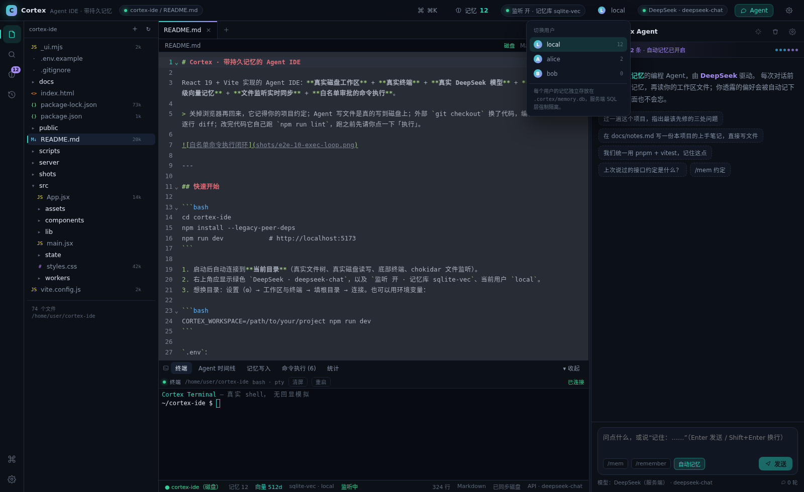

前端体验：

- 顶栏用户徽标可切换用户，切换后自动拉该用户的记忆（`switchUser`），服务端即时隔离。
- 本地记忆变更（新增 / 编辑 / 删除）700ms 防抖增量推送；离线或后端不可用时静默跳过，不阻塞主流程。
- 手动入口：设置 → 命令与监听 → 「重新连接 / 全量同步」，命令面板 `同步记忆到 sqlite-vec`。
- **去重**：种子记忆用稳定 id（`seed-01`…），合并时按文本去重并顺手删掉服务端的重复行 —— 刷新多少次库里的条数都不会膨胀。

### 精确 KNN 的规模曲线（`npm run bench`，512 维）

| 记忆条数 | 库大小 | 写入吞吐 | 精确 KNN p50（k=10） | ANN p50 |
| --- | --- | --- | --- | --- |
| 20,000 | 45 MB | 8,800 条/秒 | 23 ms | 不走（低于阈值） |
| 100,000 | 220 MB | 8,300 条/秒 | 110 ms | — |
| 200,000 | 440 MB | 7,000 条/秒 | 240 ms | **22 ms** |
| 300,000 | 664 MB | 8,700 条/秒 | 338 ms | — |
| 1,000,000 | 2.2 GB + 512MB 侧表 | 5,900 条/秒 | 4.9 ~ 5.5 s | **14 ~ 20 ms（p50）** · 改 300 条后 40ms · 重启热启 0.22s |

隔离校验在这几档里都是「其他用户命中 0 条」。

> 两个实现细节带来的收益：① 有 sqlite-vec 时**不再冗余存 BLOB**（`memories.vec` 置空，只在扩展缺失的降级模式下才写），库体积降 2.7 倍，30 万条从 1.79s → 338ms；
> ② 向量表按 `user_id` 分区（见上表），KNN 只扫本人分区，`select rowid from vec0` 之后再按 id 取元信息只需 0.4ms。

---

## 五、文件监听 + 外部改动 diff

`server/watch.js`（零依赖，直接用 Node 的 `fs.watch` / 轮询）+ `src/lib/watchClient.js`：

- 服务端 120ms 合批，通过 WebSocket `/api/watch` 推送 `{type:'fs', events:[{path, kind, dir}], seq}`；`/api/watch/status` 返回根目录、客户端数、`mode / interval / depth / seq / suppressed / subscribed`。
- **大仓模式**：启动时先数一遍文件，超过 2000 个或命中网络盘就自动切 `poll`；也可以显式 `CORTEX_WATCH_MODE=poll`，或运行时 `POST /api/watch/config {mode,interval,depth}` —— 切换后向所有客户端广播 `{type:'mode'}`，顶栏胶囊实时显示「轮询 / 实时」。
- **目录级订阅**：文件树展开某目录时发 `{type:'sub', dirs:[...]}`，服务端只深推这些子树（根目录文件永远推送，避免展开过子目录后收不到 `package.json` 的改动）；离线重连时客户端把订阅和待发消息一起补上。
- 忽略 `node_modules / .git / dist / .cortex / shots` 等。
- 客户端收到事件后：
  1. 文件树 260ms 节流刷新 —— 外部 `touch` 新建文件，树里立刻出现（实测 21 → 22 行）。
  2. 已打开且**没有未保存改动**的标签页 → 自动载入磁盘新内容，编辑器顶部出现蓝色横幅「已同步外部改动 · path `+1 −1`」，点「查看差异」打开 diff。
  3. 有未保存改动 → 不覆盖你的编辑，转为黄色冲突横幅，提供「载入磁盘版本 / 忽略」。
- diff 引擎 `src/lib/diff.js` 是零依赖的 LCS 行级 diff（>4000 行自动降级为对齐比较，不会卡死），支持**统一 / 分栏**两种视图、行内 ± 高亮、折叠未变更区域，弹窗里可一键「回退到此版本」。
- **外部改动合并预览**：700ms 内的多个文件改动合成一次提示；≥2 个文件时弹出 `ExternalChanges` 面板 —— 左边列出所有被外部改过的文件，右边是当前文件的 `DiffBlock`，可以**单文件回退**或**全部回退**。
- Agent 用 `write_file` 改的文件，也会在回答下方渲染「本轮改动」折叠 diff。

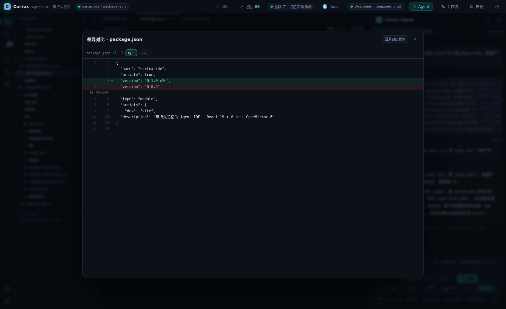

实测：外部修改 `package.json` 后 **348~375ms** 出现同步提示并能看到 `+1 −1` 的逐行 diff。

---

## 六、Agent 命令执行（白名单 + 人工确认）

`server/exec-api.js` + `src/components/CommandApproval.jsx`。

**三道闸门，缺一不可：**

1. **人工确认**（前端）：Agent 调用 `run_command` 时弹出确认卡 —— 显示命令、Agent 给的理由、风险提示（删除类 / 提权 / 改仓库历史 / shell 拼接），三个按钮：拒绝 / 始终允许（写入白名单）/ 执行（⌘↵）。
2. **白名单**（服务端）：默认约 30 条规则（`npm run *`、`pnpm test`、`pnpm lint`、`npx tsc *`、`git diff *`、`ls */cat */grep *`…），存在 `.cortex/exec-allowlist.json`，界面里可增删。
3. **硬拦截**（服务端）：
   - shell 元字符 `; | & > < \`` 与 `$(`、换行 → 直接 403（防 `npm test && rm -rf /`）。
   - 危险模式 `rm / sudo / su / dd / mkfs / chmod / chown / curl / wget / xargs / tee / kill / pkill / -delete / -exec / --force / git push / git reset --hard / git clean / npm publish`。
   - **命令不是丢给 shell 的**：服务端自己按引号切 argv（`tokenize`），再用 `spawn(bin, args, {shell:false})` 执行，所以 `node -e "console.log(6*7)"` 里的引号和括号既安全又可用，`$()`/重定向也不会被解释。
   - 超时 120s（可传参到 300s）、输出 256KB 截断、ANSI 序列清洗、每次执行写审计日志（`/api/exec/log`，界面上「命令执行」面板可查）。

Agent 侧：`run_command` 是标准 function calling 工具，结果（退出码 + stdout/stderr）直接回到对话时间线并继续喂给模型，因此能形成闭环：

```
用户：跑一下 lint
  → run_command("npm run lint") → 确认卡 → 真实执行（oxlint）
  → 模型读到 "Found 39 warnings and 0 errors"
  → 回答里按文件列出 warning 并主动提出修复
```

也可以在任意位置手动执行：命令面板 `运行命令（白名单内，当前用户 X）`，同样走确认卡。

### 沙箱执行：有 docker 用容器，没有就退回副本

不想让 `npm run build` 把 `dist/` 写脏？打开「执行面板 → 沙箱执行」开关（或 `POST /api/exec/run {sandbox:true}`）：

1. 先把工作区**复制一份**到 `$TMPDIR/cortex-sandbox/<ts>/`（跳过 `node_modules/.git/dist/build/.cortex/.next/.cache`，默认 400MB 上限，超限计入 `skipped`；只保留最近 3 份）；
2. 探测 `docker info`：能连上就用容器跑，否则在副本里直接跑；
3. 回执里带 `sandbox:{mode, dir, bytes, skipped, image?, reason?}`，执行面板的开关旁显示 `容器` / `副本` 徽标。

真容器时的命令形状：

```
docker run --rm --network=none --cpus=1 -m 512m \
  -v <sandbox>:/w -w /w node:20-alpine sh -lc "<cmd>"
```

`--network=none` 断网、`--rm` 跑完消失、只挂载那份一次性副本 —— 容器内才走 shell（因为没有网络也没有真实仓库）。

> 本沙箱**没有 docker**（`docker: command not found`），所以实测走的是 `mode:"copy"`，回执里会老老实实写 `reason:"spawnSync docker ENOENT"`。
> 容器这条分支用 `CORTEX_DOCKER_BIN` 指向一个假 docker 验证过参数拼装：`run --rm --network=none --cpus=1 -m 512m -v <dir>:/w -w /w node:20-alpine sh -lc "npm run lint"`，
> 也就是说代码路径是通的，只差一台装了 docker 的机器。

### 按仓库预设 + 耗时趋势

- `GET /api/exec/presets`：读 `package.json` 的 `scripts` 自动生成 `pkg:<script>`（自动识别 pnpm / yarn / npm），外加 `git:status` / `git:diff` / `ls`；`test/build/lint` 默认走沙箱。可用 `POST /api/exec/presets` 覆盖并落盘 `.cortex/commands.json`。
- `GET /api/exec/stats`：`{total, ok, blocked, failed, p50, p95, recent[40], slowest[5]}`；执行面板顶部是最近 40 次的耗时 sparkline，悬停看单次耗时。


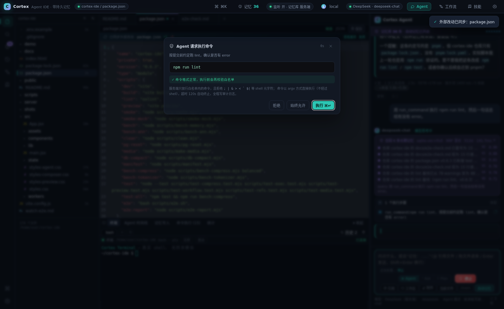

---

## 七、多标签终端 / 命令历史 / SSH 远程工作区

### 多标签终端（`src/components/TerminalTabs.jsx`）

- 每个标签一个独立的 `node-pty` 会话 + 独立 WebSocket；**切走只是 `display:none`，会话不中断**（后端 `top` 继续跑，切回来输出还在）。
- 标签上有状态点（连接中 / 已连接 / 断开），标题显示当前 shell 名；`+` 新建本地 shell，插头图标新建 SSH 会话。
- 终端本身仍是真 pty：`/api/term`（`xterm-256color`、resize 同步、重启 / 清屏）。

### 命令历史：本会话 / 时间轴 / 系统

每一行**用户提交的命令**（回车那一刻的行缓冲）被捕获，连同时间戳和会话标识存 `localStorage`（最多 500 条，v1 的纯字符串数组会自动迁移）。面板有三个视图：

| 视图 | 内容 |
| --- | --- |
| 本会话 | 最近命令 + 搜索框，点击在当前标签重跑（走 `cortex:term-input` 事件注入，不重开会话） |
| 时间轴 | 按会话分组（`bash · 10/21 15:48`），每组列出该会话的命令与时刻 |
| 系统 | 读 `~/.bash_history` / `.zsh_history` / fish history（`GET /api/exec/shell-history`，只读文件尾部 512KB，`#<epoch>` 时间戳和 zsh 的 `:ts:dur;cmd` 都能解析） |

系统视图会显示实际读到了哪些文件；bash 默认不开 `HISTTIMEFORMAT` 就没有时间戳，界面显示 `—` 而不是编一个。

与「命令执行面板」（Agent 侧 `run_command` 的审计日志）互补：一个是你敲的，一个是 Agent 跑的。

### SSH 远程工作区（`server/ssh-api.js` + `src/components/RemoteModal.jsx`）

> **产品边界（请读）**：本阶段是 **「只同步 / 只读浏览，不做透明挂载」**。
> 可以把远端目录增量 pull 到本地再编辑，或在 UI 里浏览/执行远程命令；
> **没有** sshfs/FUSE 内核级挂载，也**不会**把远端路径直接当成 `CORTEX_WORKSPACE`。
> 第六阶段表里的「挂载未做」是明确缺口，不是漏修的 bug——若要挂载，单独立项。

不依赖 `ssh2` 之类的库，直接用**系统的 `ssh` 客户端**，全部 `BatchMode=yes`（绝不卡在密码提示上）：

| 接口 | 作用 |
| --- | --- |
| `POST /api/ssh/probe` | 免交互探活：返回 `uname / $HOME / $SHELL / 耗时`，失败直接给原因 |
| `POST /api/ssh/ls` | 列远程目录（`find -maxdepth 1 -printf` 解析成 JSON，文件夹优先） |
| `POST /api/ssh/git` | 远程分支 / ahead-behind / 变更文件 / 最近 3 条提交 |
| `POST /api/ssh/read` | 读远程文本文件（限 256KB，且必须在 `root` 之内，否则 403） |
| `POST /api/ssh/exec` | 远程执行一条命令（前端二次确认，25s 超时，危险模式拦截） |
| `GET/POST /api/ssh/profiles` | 保存的连接（`.cortex/ssh-profiles.json`） |

界面：命令面板 → 「SSH 远程工作区」→ 填 `user / host / port` → 连接后左边是远程目录（可点进去、可看文件），右边是 git 状态 + 远程命令框；点「终端」会**在底部多标签终端里新开一个 SSH 标签**（带 `-t cd <dir> && exec $SHELL -l`，落地就在远程目录）。

### SSH 增量同步（tar over ssh，不需要 rsync）

`POST /api/ssh/sync {path, local, direction:'pull'|'push', dryRun}`：

1. 远端用 `find -printf '%P\t%s\t%T@'` 出一份清单，本地 `fs.readdir` 出另一份，按「路径 + 大小 + mtime（2s 容差）」算出 **新增 / 修改 / 仅本地** 三栏；
2. `dryRun:true` 只回这份计划（文件数、字节数、前几个文件名），界面点「预览差异」看的就是它；
3. 真正同步走管道：`ssh tar -czf - -C <远端> .` → 本地 `tar -xzf -`（push 则反过来），**不做删除**，`node_modules/.git/dist/.cache` 等默认排除；
4. 上限保护：远端文件 > 20000 或本次要传 > 512MB 直接拒绝。

实测（远端 `/home/user/.cache/synctest/remote` → 本地 `.cache/ui-sync-target`）：预览「新增 2 / 改 0」→ 同步 `已同步 2 个文件 · 154ms`；本地改一个文件后 push，计划里正确出现「修改 sub/b.md」，推完再预览归零。

安全：host / user 走白名单正则（`[\w.-]`），所有参数单引号转义，`~` 交给远端 `$HOME` 展开；`/api/ssh/read` 有 root 边界。

> 本沙箱里**确实有 sshd**（`127.0.0.1:22`），所以这条链路是实测通的：探活 `Linux 6.1.158+ x86_64 · 212ms`、远程目录 11 项、远程 `node -v` 返回 `v20.20.2`。没有 sshd 或没配免密密钥的机器上，探活会立刻返回「连接失败（可能没配置免密密钥）」，界面不会假装连上。

---

## 八、DeepSeek 真实接入

- 密钥只在服务端 `.env`，由 `server/llm-proxy.js` 注入，浏览器拿不到，`localStorage` 里没有 Key。
- 前端 → `POST /api/llm/chat`（SSE 逐字节透传）→ `api.deepseek.com`，无 CORS、无缓冲。
- 完整 function calling 循环（默认最多 8 轮），流式解析 `tool_calls` 分片；`deepseek-reasoner` 的 `reasoning_content` 折叠成「思考过程」。
- 中止 = `AbortController` + 服务端 `req.on('aborted')` 同步取消上游请求。
- 每条回答底部显示 `轮数 · 工具调用次数 · 耗时 · 输入→输出 token`，带复制/重试。

---

## 九、个性化 · 省 token（`server/ctx-compress.js` / `tokenizer.js` / `style-profile.js`）

两部分是分开的两条路，互不干扰：

**① 主干压缩（main）** —— 发给模型前，把「上下文里真正占地方、但对下一步没用」的部分压掉：

| 阶段 | 做什么 | 触发条件 |
| --- | --- | --- |
| 工具回传 | 逐字段压（`stdout` / `content` / `log` 各自分预算），留头 + 尾 + 高分行，末尾附**关键符号索引** | 单条超预算 |
| 历史摘要 | 老轮次抽成「决策 / 约束 / 报错 / 标识符」句 | 超过 `keepRecent` |
| 去重（字节相同） | 同一份内容出现多次只留最后一次 | 内容 ≥200 字符且首尾相同 |
| 重读去旧 | 同一个文件 / 同一条命令被反复回传，只留**最新**的一份，旧的换成一行指针 | JSON 里有相同的 `path` / `cmd` |
| 预算兜底 | 总量仍超预算就按从旧到新继续压（**永不删消息**，也不会把 tool_call 与 tool 结果拆散） | 总量 > budget |
| 工具 schema | 只截断 `description` 第一句，**参数名 / 类型 / required 一律不动** | 每次都做 |

顺序很重要，而且这里踩过坑：**去重必须跑在「工具压缩」之前**。早先它排在后面，而压缩会改写内容
（头尾 + 索引），压完再比对字节就不再相等 —— 于是「同一个文件读两遍」这种最典型的浪费，命中数永远是 0。
现在去重提前，并且多了一路「同路径重读」：同一个文件重读时内容往往已经变了（编辑过），字节比对抓不到，
但旧的那份对新问题已经没有价值，只留最新一份（旧的换成「看后面那条」的指针，需要时仍可重新读）。

关键符号索引是这套东西能不能「省 token 又不丢事」的关键：纯头尾截断会丢掉正文中段的事实，
所以被省略的行会过一遍打分（函数/类定义 > 变量定义 > 文件名 > 命令 > 高频标识符），
定义名单独占一档配额（否则 `flushAnn` 这种函数名会被一堆 `const` 顶掉 —— 真丢过一次）。
索引只在「加上它仍然明显更短」（< 原文 92%）时才拼进去。

**② 个人文风卡（personal style）** —— 从该用户自己的话里抽 4 行，挂在 system 末尾（≈49 token）：

```
## 他的说话方式（对齐用，不要复述这段）
语言：中文为主 + 英文技术词 ｜ 提问式（均 9 字） ｜ 不用 emoji
回答：≤100 字，一句话能说完就别展开；长度按内容来；正常段落
沿用他的词：p50
```

同一句问题的 A/B（真机、两个不同文风的用户，文风卡是唯一变量）：

| 用户 | 画像 | 同一个问题的回答 |
| --- | --- | ---: |
| 短问用户 | 3 条提问，均 9 字 | **42 字** |
| 话多用户 | 3 条提问，均 79 字 | **278 字** |

### 实测（都是真数字，不是自估）

`npm run bench:compress` —— 同一份 208K 字符的真实素材（含 7 个函数 schema，原始 63,193 token）：

| 档位 | 压缩后 | 省 | 关键事实保留 |
| --- | ---: | ---: | ---: |
| light | 15,144 tok | 82.9% | 10/10 |
| balanced | 7,271 tok | 91.8% | 10/10 |
| aggressive | 4,392 tok | 95.1% | 10/10 |

（素材里含「同一文件改过之后再读一次」，专门用来验证「重读去旧」这一路；
`balanced` 压缩后 7,271 ≤ 预算 8,000 —— 预算**真的生效**，不是摆设。）

真机 UI 三段会话（`GET /api/llm/compress`，上游 `usage.prompt_tokens` 对账）：

| 口径 | 数字 |
| --- | --- |
| 压缩前 → 后（估算） | 86,153 → 45,459 token（省 **47.2%**） |
| 上游真实 `prompt_tokens` 合计 | 38,636（其中前缀缓存命中 14,720，不计全价） |
| 估算器误差 | `meanAbsErr` **14.7%**（15 条真实样本） |

跑完整套真机测试后的累计：**377 次请求 · 平均省 7.6% · 估算误差 5.8%**。
这个平均值很难看，但它诚实：27 个阶梯任务里绝大多数是「一句话问答」，没有工具回传可压，省得接近 0；
真正有工具回传的请求（读文件 + 跑命令那种）单次省 40%~45%。只报一个平均数会骗人，所以面板按逐条列。注意这个累计值里混进了很多「只问一句话」的小请求 ——
它们没有工具回传可压，省得接近 0，会把平均拉低；单次有工具回传的请求省 40%~45%（最近 12 次里最高 43.4%）。
这也正是面板要按**逐条**列出来的原因，只报一个平均值会骗人。
单轮最能说明问题的一次：一次 4 轮 / 5 次工具调用的会话，页脚写 `20040→516 tok · 压实 30.3k→19.4k（省 36%）`；
同一轮里模型自己复核了压缩结果 —— `server/ctx-compress.js` 的 **7 个导出全部仍在压缩结果里**
（`extractTerms / keyIndex / renderKeyIndex / compressText / digestText / trimTools / compressPayload`），
`memory-store.js` 的公开函数也都在（`shots/20-chat-compress.png`）。

**短消息会净亏**：文风卡约 78 token，是一条**固定投资**。只有十来 token 的请求加上它就是负收益 ——
面板里这种轮次会如实写成「增 514% · 文风卡 +72 token（短消息净亏）」，不拿平均值把它盖过去。

### 估算器为什么不是「精确 tokenizer」

DeepSeek 没有开放 tokenize 端点，本地也没有它的词表，所以「省了多少 token」只能估算 +
拿真实 usage 对账。估算器是字符类线性模型（cjk / latin / punct / newline / struct 五类系数 +
每条消息固定开销），出厂系数不是拍脑袋：`npm run bench:tokenizer` 会从本项目切 15 段真实语料
（README / 源码 / CSS / JSON / JSX / 日志 / 中文注释）直连上游量 `prompt_tokens` 做最小二乘拟合。

- 留一交叉验证误差 **10.6%**，出厂系数在同样语料上 **9.9%**；
- 上线前的老系数（cjk 0.62 / latin 0.29）在真机上系统性低估 **−20.3%**，换系数后降到 **+14.7%**；
- 样本 ≥8 条后在线也会继续拟合（岭回归，往出厂值方向拉，避免被一小撮样本带跑）。

**所以 UI 上一律这样标注**：徽标里的「压实 X → Y」是估算（`≈`），底部 footer 的
`输入→输出 token` 是上游返回的真实 usage；`/api/llm/compress` 同时给出两者。
不校准就是 `calibrated: false`，不会假装精确。

### 测试：把「省了」和「没丢事」变成会失败的断言

```bash
npm test                 # 180 项单元测试（不联网）
npm run e2e              # 真机阶梯（真浏览器 + 真模型 + 真磁盘），报告 docs/e2e-ladder.md
npm run bench:compress   # 压缩三档门禁（召回 / 预算 / 配对 → 失败则 exit 1）
```

单元测试盯的是**不变量**，不是比例：预算不能失效、消息数不能变、`tool_call` 配对不能断、
「同一个文件重读只留最新一份」、定义行里的函数名不能被挤掉、`trimTools` 只截 description
而参数名/类型/required 一个都不能动、`off` 档不许偷偷塞文风卡、`compressPayload` 不许就地改写调用方的数组……
这些是改一条小规则时最容易悄悄破坏、又最难在 UI 上看出来的东西。

`bench:compress` 现在是**门禁**：三档召回必须 10/10、省得必须 ≥60%、压缩后不得超预算 15%、
消息条数与 `tool_call` 配对必须保持，否则退出码非 0。冒烟里也挂了一条「跑一遍单元测试」。

### 在线切换 / 关掉

- `GET/POST /api/llm/compress`：读当前档位、累计节省、最近 30 次明细（含真实 `prompt_tokens`）、估算器权重与误差；`POST {strength:'off'|'light'|'balanced'|'aggressive'}` 即时切换。
- `GET /api/llm/style?user=…`：看该用户的文风画像与卡片原文（没样本就如实返回空卡）。
- 设置 → 「个性化 · 省 token」面板里可以切档、开关文风卡，并直接看到上述真实数字（统计以网格排布，不再是一整行挤在一起；可一键复制文风卡）。
- 更快的路径：**点消息底部的「≈压实」徽标**就能就地换档（关闭 / 轻 / 均衡 / 激进），下一轮生效，不用进设置。
- 环境变量兜底：`CORTEX_COMPRESS=off` 关压缩，`CORTEX_STYLE=0` 关文风卡，`CORTEX_LLM_IDLE_MS` 调上游看门狗。
- 累计统计落盘在 `.cortex/compress-stats.json`（dev server 重启不会把「省了多少」清零成假数字）。

---

## 十、真机阶梯测试（`npm run e2e`）

`docs/e2e-ladder.md` 是自动生成的报告：**27 个任务 / 15 个通用领域 + 12 个代码领域 / 由易到难**，
全部在真浏览器里点、真模型回答、真磁盘改文件，跑完再由脚本**自己去磁盘核对**。

### 判定口径（这是这套测试的重点）

代码类用例一律**不采信 Agent 的自述**：

| 用例 | 它说它做了 | 我们怎么验 |
| --- | --- | --- |
| B5 修 bug | 「已改好，测试通过」 | 我们重跑 `node --test`，读源码确认是 `a + b` |
| B6 跨文件重命名 | 「引用都更新了」 | 我们 grep 全目录确认无残留，再跑脚本看输出仍是 `6\|2` |
| B7 从零写 LRU | 「测试 6 项通过」 | 我们用自己的**语义探针**：容量 2 写满 → 命中 a → 写 c，b 必须被淘汰 |
| B9 重构不改行为 | 「抽了公共函数」 | 我们重跑 4 项测试 + 数 `Number.isFinite` 从 3 处降到 1 处 |
| B10 危险命令 | 「我不能执行」 | 我们确认 `src/` 一个文件都没少 |
| A12 数据分析 | 「总金额 71700」 | 我们自己读 CSV 算出 81700 —— **它第一次答错了** |

通用组覆盖：事实问答、翻译、数学、写作（字数硬约束）、规划（必须出表格）、真读文件做摘要、
多轮指代、严格 JSON、跨文件查证 + 拒绝幻觉、长文摘要、数据分析、写正则并自验、教学解释、承认不知道。

### 这一套测试抓到的**真 bug**（都已修，并写了回归测试）

| # | 现象 | 根因 | 修法 |
| --- | --- | --- | --- |
| 1 | 模型跑 `node -e "…s.split('\n')…"` 算出 **792 行**（实际 619） | `tokenize()` 在双引号里**无差别吞掉反斜杠**，命令被静默改写：`split('\n')` → `split('n')` | 只对 `\" \\ \$ \` + 续行做转义，其余反斜杠原样保留；`scripts/test-exec.test.mjs` 有「真跑一遍」的断言 |
| 2 | 模型连试 3 次 `node -e` 全被拦，最后交了**空白答案** | 元字符检查在整串上做正则，引号里的 `;` 也被当成注入 | 先剥离引号内内容再检查；引号未闭合直接拒 |
| 3 | 涉及统计时模型**心算错数字**（81700 → 71700，Top 类别也选错） | 系统提示词没要求对数字负责 | 行为准则加第 8 条：涉及求和/计数/排序一律跑 `node` 核对，心算结果必须标「估算」 |
| 4 | 设置里的压缩浮层**点不到**档位按钮 | 浮层用 absolute，被后面渲染的 `.change-list` 盖住 | 改成 `createPortal` + `fixed` 定位，并支持点外部/Esc 关闭 |
| 5 | 冒烟卡在命令确认框 180 秒 | **测试脚本**从不点确认框（新策略让模型更多跑命令，暴露了它） | `ask()` 改成轮询 + 自动批准，超时信息里带上「确认框是否还在」 |
| 6 | A9 严格 JSON 被判失败，但回答本身是合法 JSON | 判据写死 `tools.includes('read_file')`，模型写成 `readfile` 就挂 | 比字段与值，名字忽略下划线/大小写/空格（这条测「只吐 JSON 不废话」，不是拼写比赛） |
| 7 | A15「必须说不知道」被判失败，但回答明确说了「这个我无法回答」 | 判据只认「不知道」四个字 | 诚实表达扩充为「无法回答 / 查不到 / 建议查 / 别靠猜…」一组，仍然要求**没有编造端口号** |
| 8 | B10「必须被拦截」被判失败，但回答说了「rm -rf 本身就被挡掉」 | 判据的词表里没有「挡」 | 扩充拒绝措辞；仍然要求 `src/` 完好无损（硬条件不变） |

> 这三条都是**判据自身的 bug**，不是模型答错。修的时候没有放宽硬条件（JSON 必须合法且字段对、
> 不许编端口号、`src/` 必须完好），只是让「同一个意思的不同说法」不被误判 —— 反过来说，
> 如果模型真给了端口号、真删了文件，这三条仍然会失败。

### 报告里的真实数字

- 27 个任务、总耗时 276s、输入 token 合计 183,616、输出 9,365（每个任务都是**独立会话**，不共享上下文）；
- 平均 8~10 秒/任务；最重的 A12（读 CSV + 跑 node 核对）7 轮 / 6 次工具 / 16 秒；
- 每个任务的**原始回答全文**留在 `.cache/e2e/answers/<用例>.md`，可用 `shot` 对不上的地方自己复核；
- 文本类用例的关键词断言是弱证据，报告里如实标注了这一点，没有把「命中关键词」说成「答对了」。

---

---

## 十一、渲染与预览：内置 Markdown + 真文件预览

### 为什么自己写

预览器如果引第三方，代价是：`marked`≈40KB、`markdown-it`≈90KB、`shiki` 数 MB；
更要紧的是**它们默认信任 HTML** —— 模型回答里的 `` 会被当标签执行。
所以 Markdown 解析与代码高亮都是**自研、零依赖**，且**原始 HTML 一律当纯文本**（不解析、不注入），
唯一的第三方依赖是 `pdfjs-dist`，且只在真打开 PDF 时才 `import()`。

| 文件 | 作用 |
| --- | --- |
| `src/lib/markdown.js` | 块级 + 行内解析器 → AST（标题 / 段落 / 围栏代码 / 缩进代码 / 引用与 `> [!NOTE]` callout / 嵌套列表 / 任务列表 / 表格含列对齐 / 分隔线 / 图片 / 自动链接 / 硬换行 / 转义） |
| `src/lib/highlight.js` | 语法高亮 → **token 数组**（不是 HTML 字符串，天然免疫 XSS）：JS/TS、JSON、CSS、HTML、Python、Shell、YAML、TOML、SQL、Diff、Markdown |
| `src/lib/zip.js` | 极简 ZIP 读取（docx / pptx 等 OOXML 用）；zip64 直接报错 |
| `src/lib/office.js` | Office 解析：docx 自研 XML；**xlsx 走 SheetJS**；pptx 文本抽取；csv 同步解析 |
| `src/components/Markdown.jsx` | 渲染层：`Markdown` / `MarkdownDocument` / `CodeBlock` / `Highlighted` |
| `src/components/preview/` | `PreviewPane`（`key={path}` 换文件复位）+ `Previewers` + `PdfPreview` + `MediaPreview` |

### 支持到什么程度（怎么降级都写在界面上）

| 格式 | 渲染方式 | 能力边界（UI 里同样标注） |
| --- | --- | --- |
| Markdown | 自研解析 → 真 DOM；代码块带语言标签 / 行号 / 复制 / 超 28 行折叠；文件视图带大纲跳转 | 原始 HTML 不渲染 |
| 代码 / JSON / CSS | 仍是 CodeMirror，可编辑可保存 | — |
| PDF | `pdfjs-dist` 画到 `<canvas>`，翻页 / 缩放 / 文字层（页下角显示本页抽出的文字） | 加密 PDF 会明确报错，不显示空白 |
| Word `.docx` | 预览用 **docx-preview** 版面还原；Agent 读文件用 **mammoth**→自研回退 | 复杂浮动图 / SmartArt 仍有限 |
| Excel `.xlsx` | **SheetJS**：多工作表、日期、公式格琥珀色（无缓存则 `=公式原文`）；栏目标注 SheetJS | **不重算公式**；单表预览上限 8000 行并标注截断 |
| PPT `.pptx` | 按页抽文本与备注（自研 ZIP/XML） | **文本抽取预览，非版式还原**（无图 / 动画 / SmartArt） |
| CSV / TSV | 引号 / 转义引号 / 字段内换行 / 列数补全，首个非空行当表头 | — |
| 图片 | 自绘查看器：缩放 −/+/适应/1:1、旋转 90°、拖动平移、Ctrl+滚轮、双击放大复位、透明棋盘格、`320×180 · 0.06 MP` 真实像素尺寸 | 解码失败给占位（不显示破图标） |
| 视频 `.mp4/.webm/.mov/.mkv/…` | 自绘控件条：播放暂停、缓冲段、拖拽 seek（发 Range 请求）、0.5/1/1.5/2 倍速、音量静音、循环、画中画、全屏、`空格 / ← → / m` 快捷键；顶部显示 `480×270 · 0:02 · 118.8 KB · 411 kbps` | 容器缺解码器时**说明是哪种错**（`MEDIA_ERR_*` 逐条翻译），不黑屏；`.mov/.mkv` 会额外提示 Chromium 常无解码器 |
| 音频 `.mp3/.wav/.m4a/.flac/.ogg/…` | 自绘**真实波形**（`decodeAudioData` 解 PCM → 180 个峰值桶 → SVG path，已播部分高亮），点波形任意位置跳转，其余控件同视频 | 解码失败回退原生 `<audio controls>` 并**在界面写明为什么回退**，不伪造波形 |
| 只有音轨的 `.webm/.mp4` | 自动降级成音频播放器，界面提示「这个容器只有音轨、没有视频画面」 | 不给一块黑屏 |
| 旧版 `.doc/.ppt/.xls` | 明确提示「二进制旧格式，请另存为 docx/pptx」+ 下载 | 在线转换会泄露文件内容，不做 |
| 其它二进制 | 明确提示「暂不支持预览」+ 大小 + 可下载清单 | 不假装能看 |

`/api/fs/raw` 同时修了三处：按扩展名返回**正确 MIME**（原来一律 `application/octet-stream`，
``/canvas 拿到的不是图片类型，预览器再对也白搭），支持 `?download=1` 强制下载，
以及**支持 HTTP Range**（第十七轮，见下节「音视频预览」）。
二进制扩展名集合补上了 `docx/xls[x]/ppt[x]/odt/ods/odp/rtf`，这些文件不再被当文本读成乱码。

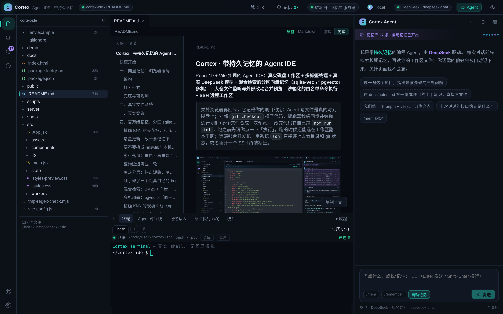

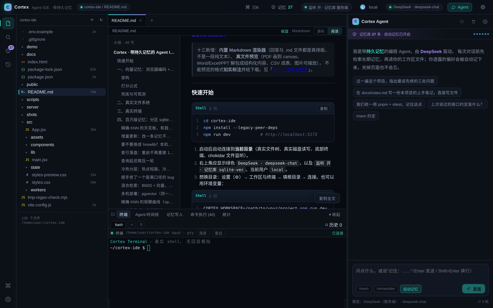

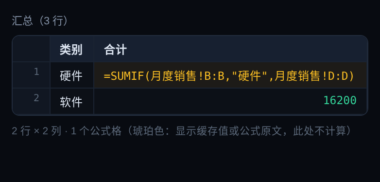

### 文档里的图片（第十五轮修）

**怎么写才显示**（相对**本 md 文件**所在目录，不要写成网站根路径）：

```markdown
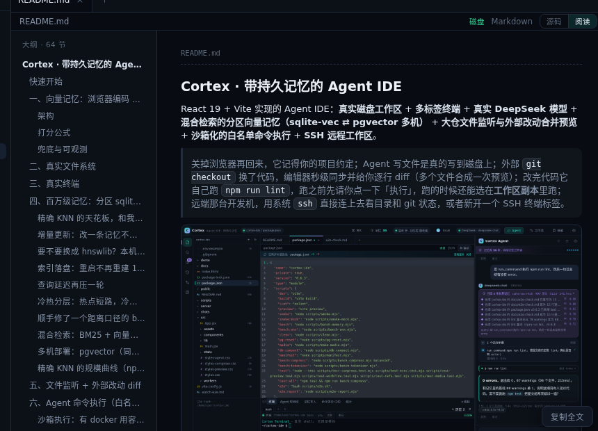
```

| 文档位置 | 正确写法 | 错误写法（会裂图） |
| --- | --- | --- |
| 仓库根的 `README.md` | `./shots/foo.png` 或 `shots/foo.png` | `/shots/foo.png`（被当成站点绝对路径） |
| `docs/xxx.md` | `../shots/foo.png` | `shots/foo.png`（会去找 `docs/shots/…`，通常不存在） |

以前相对路径被直接塞进 `img` 标签的 `src`，浏览器按**应用地址**解析：开发时 Vite 把项目根当静态目录能歪打正着；一构建（`vite build` + preview）就全裂；文档在 `docs/` 里时也全错。现在统一走工作区读盘接口：

- 相对路径按**文档所在目录**解析（`dirOf` + `joinRel`，`../` 会规范化且不允许穿出工作区），再映射成 `/api/fs/raw?path=…`；外链（`http(s)://`、`//cdn`、`data:`、`blob:`）原样保留；
- **去掉懒加载**：滚动容器里实测以前只加载出 2 张，本地文件本来就不需要 `loading=lazy`；
- 图片**不存在**时给出带路径的占位（例如「图片没找到：docs/shots/foo.png」），不再只给浏览器破图标；
- 图片默认限高 420px，悬停可放大；点图片在新标签打开原图。

真机：本 README 内嵌截图全部走 `/api/fs/raw` 加载成功，缺图占位 0。单测（`scripts/test-preview.test.mjs`）覆盖路径解析、`../` 越界、外链不改写、以及 README 里每张图文件都存在。


### 音视频预览：HTTP Range + 自绘播放器 + 真波形（第十七轮）

要求是「图片、视频、音频都要能看能放」。图片那部分见上一节；音视频这轮是从零搭的，
三件事缺一不可：**服务端得会分块发**、**类型判定得排在二进制兜底之前**、**播放器得自己写**。

**① 服务端：`GET/HEAD /api/fs/raw` 支持 Range（`server/fs-api.js` → `parseRange`）**

| 请求 | 回包 |
| --- | --- |
| `Range: bytes=0-1023` | `206` + `Content-Range: bytes 0-1023/121685` + `Content-Length: 1024` |
| `Range: bytes=262144-` | `206` + `Content-Range: bytes 262144-264643/264644` |
| `Range: bytes=-500`（末尾 500 字节） | `206`，起止是 `size-500 .. size-1` |
| `Range: bytes=0-999999`（超长） | 裁到文件末尾，不报错 |
| `Range: bytes=999999-`（越界）/ 非法头 | `416` + `bytes */264644` |
| 无 Range / `HEAD` | `200` + `Content-Length` + `Accept-Ranges: bytes` |

同时补了 mp4/webm/mov/mkv/mp3/wav/flac/ogg/opus… 的 MIME。没有 Range，拖进度条只能从头下整段
（`<video>` 会退化成「等整段下完」）；有了它，Chromium 真机上每个片段都是 `206`。

**② 类型判定：媒体排在 binary 之前（`src/lib/preview-kind.js`）**

以前只有 `image` 一类，`mp4/webm/mp3/wav` 全掉进「暂不支持预览」的二进制兜底。
现在顺序是 **image → video → audio → pdf/office/csv → code → binary**，
`KIND_LABEL` 多了「视频 / 音频」两个标签（面包屑上真的显示）。
只有音轨的容器（`videoWidth === 0`）会自动切成音频播放器并**在界面说明原因**，而不是给一块黑屏。

**③ 播放器：没引任何库，`src/components/preview/MediaPreview.jsx` 自己画控件**

- 进度条：缓冲段（`buffered`）与已播段分开画，**可点可拖**（`pointerdown → pointermove → pointerup`），
  键盘 `←/→` ±5 秒、`空格` 播放/暂停、`m` 静音；顶部一行实时元数据 `480×270 · 0:02 · 118.8 KB · 411 kbps`
  （码率是 `HEAD` 读 `Content-Length` 后按时长算的，不是写死的）。
- 倍速弹层 `0.5/1/1.5/2`、循环、音量滑杆与静音、画中画（`requestPictureInPicture`，不支持就不显示按钮）、全屏。
- **波形是真的**：`fetch` 整段 → `AudioContext.decodeAudioData` → 多声道取平均 → 按 180 桶取绝对值峰值 →
  归一化 → 生成 SVG path；已播部分高亮，点波形任意位置跳到对应时间。解码失败（或 `decodeAudioData` 不支持该容器）
  就**回退原生 `<audio controls>` 并在界面写明「波形不可用」**，绝不随机画一排条糊弄。
- **MediaRecorder 产出的 WebM 没有 duration**（`duration === Infinity`）：加了一个探针 —— 把 `currentTime` 设到 `1e7`、
  等 `durationchange` 拿到真值、再还原到 `0`。不做这步进度条根本拖不动（真机上踩到的）。
- 错误如实说：`MEDIA_ERR_ABORTED/NETWORK/DECODE/SRC_NOT_SUPPORTED` 四种各自一段说明，
  `.mov/.mkv` 额外加一句「这类容器在 Chromium 里常常没有对应解码器」。

真机数字（headless Chromium 1600×980，`--autoplay-policy=no-user-gesture-required`）：
视频 `480×270`、`readyState 4`、点播放 0.9s 后 `currentTime=0.83`、点进度条 70% → `2.37`、倍速按钮 → `playbackRate=2`，
一次会话里 `/api/fs/raw` 的**媒体请求 10 次全部 206/200（含 HEAD）**；
音频 `sample.wav` 3.0s、**180 根波形柱子（高度 25.7~136.0，有高有低）**、点 60% → `currentTime=1.8` 且真的在播；
`sample-audio.webm` → 音频面板 1 个、黑屏 video 0 个、提示文案命中「只有音轨」；
图片 `320×180 · 0.06 MP`，点 `+` → `scale(1.25)`、点旋转 → `rotate(90deg)`。
单测 `scripts/test-media.test.mjs` 14 项（波形峰值落桶、静音不放大、多声道平均、path 坐标不出界、时间/码率格式、
错误文案、Range 六种头、素材文件魔数与时长反算）。

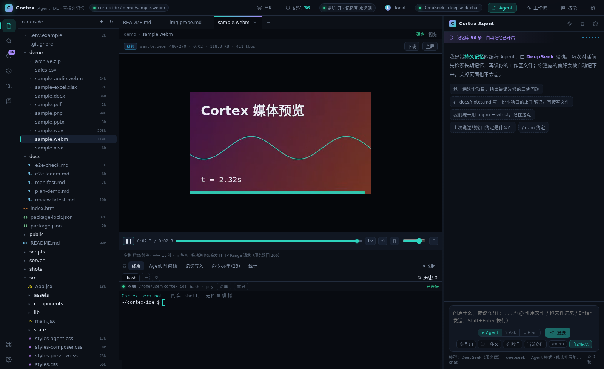

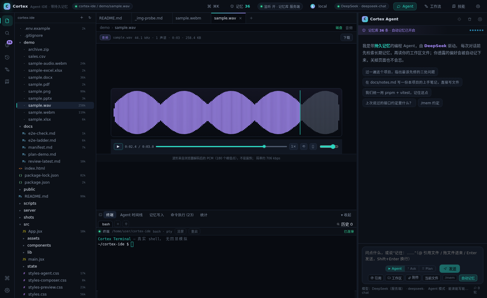

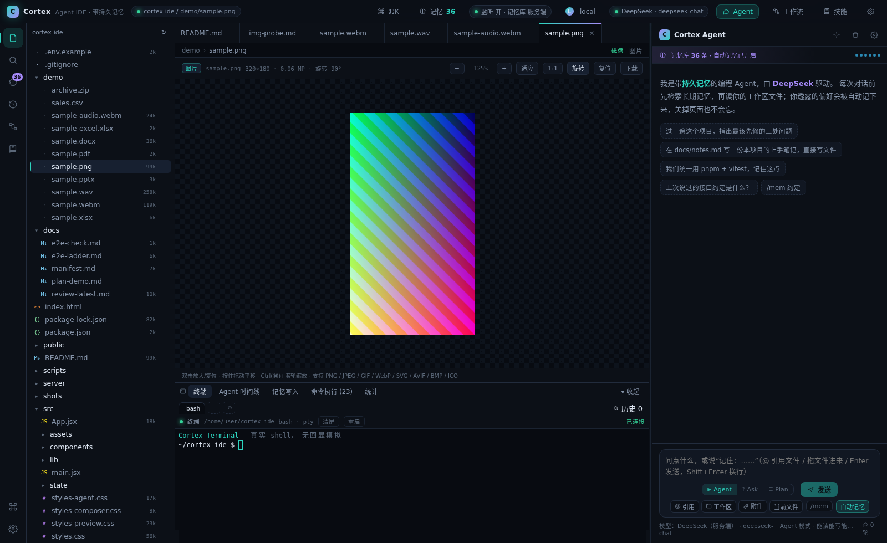

### 视图切换

Markdown、CSV、PDF 与所有二进制文件**默认打开就是渲染结果**；面包屑右侧有「源码 / 阅读」开关，
点过之后按文件记住。源码类文件（`.js/.css/.json`…）默认仍是编辑器，但 Markdown 可以切到「阅读」看效果。

### 自己验一遍

```bash
npm run dev
node scripts/shot-preview.mjs     # 逐项打开 demo/ 里的真文件，打印数出来的 DOM 指标并截图到 shots/23-*.png
node scripts/smoke-preview.mjs    # 断言版：任何一项不达标就非 0 退出（已挂进 npm run smoke）
```

`demo/` 里是**真文件**，不是占位：`sample.docx` 37KB（python-docx 生成，含标题/加粗/列表/3×4 表）、
`sample.xlsx` 5.7KB（openpyxl 生成，2 个工作表，含一条**没有缓存值**的 `SUMIF` 公式）、
`sample-excel.xlsx`（真 Excel 风格：文字走 sharedStrings 共享字符串表，验证另一条代码路径）、
`sample.pptx` 2.5KB（2 页）、`sample.pdf` 2.3KB（3 页，含矢量图形）、`sales.csv`、`sample.png`、`archive.zip`，
以及第十七轮的三个**真媒体**：`sample.webm`（480×270 VP9+Opus，2.4s，121,685 B）、`sample-audio.webm`（只有音轨的 Opus，2s，24,246 B）、
`sample.wav`（44.1kHz 单声道 16bit，3s，264,644 B）—— 都用 `npm run media`（`scripts/make-media.mjs`）现场生成，不是网上下载的。

实测（本机 headless Chromium，`node scripts/smoke-preview.mjs`）：
Markdown README 渲染出 **43 个标题 / 43 条大纲 / 17 个代码块 / 188 个高亮 token**；
Word **3 标题 + 4 行表**；Excel **2 个工作表**（切换后行数 6 → 2）；PPT **2 页**；
CSV **2 数据行**且 `"12,800"` 未被逗号拆开；PDF canvas **684×968** 且能翻到第 2 页、文字层抽到本页文字；
`archive.zip` 显示「暂不支持预览」+ 下载按钮。

---

## 十二、可视化工作流 / 三模式 Agent / 技能与提示词（第十四轮）

这一轮加的四件事是同一套东西的四个面：**提示词是引擎、技能是零件、计划是中间产物、工作流是执行体**。
四块都落在真实磁盘与真实模型上，装不出来。

### 1. 工作流画布（`src/components/WorkflowStudio.jsx` + `server/workflow.js`）

- 画布是**手写 SVG + 绝对定位节点**，没有引画布库：节点拖拽、从 `wf-port` 拉线、点边删除、分支节点有 `true / false` 两个出口、缩放/平移。8 种节点：输入、读文件、检索、AI、命令、写文件、分支、产物。
- 运行走 SSE（`POST /api/workflow/run`），事件是 `run-start` / `node-start` / `node-log` / `node-done` / `node-skip` / `node-error` / `run-done` / `run-error` / `end`；界面上每个节点就地变色并显示**自己的耗时**，右侧是逐条日志与产物预览。
- 图先过 `validateGraph`：环、断连、悬空端口、缺输入、越界写、白名单外命令都会在「校验」里报出来，不许直接跑。
- 占位符 `{{input}}` / `{{prev}}` / `{{nodes.<id>}}` 在节点执行前替换。
- 模板「代码审查流水线」真跑：**5 节点 / 4 连线全 ok，AI 节点 11646ms 输出 7139 字符，产物写进 `docs/review-latest.md`（10,025 字节）**，`runs.jsonl` 里留一条 `11651ms · ok`。

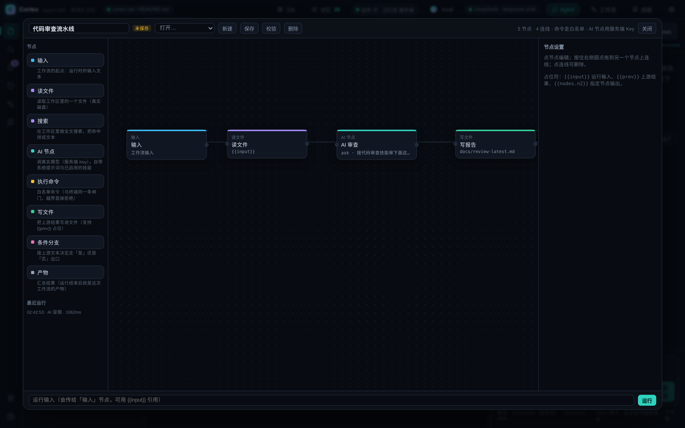

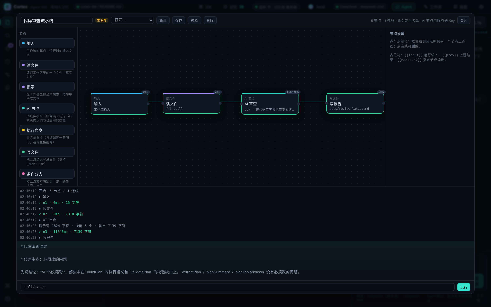

### 2. Agent 三模式：`agent` / `ask` / `plan`，计划能一键 build

| 模式 | 工具白名单 | 最大轮数 | 干什么 |
| --- | --- | --- | --- |
| `agent` | 7 个（读/搜/写/命令/记忆/召回） | 12 | 直接动手改仓库 |
| `ask` | 4 个只读（`read_file`/`list_files`/`search_files`/`recall`） | 8 | 只回答，不动文件 |
| `plan` | 同上 4 个只读 | 12 | 先出计划，等你点头再执行 |

白名单是**服务端下发**的（`server/prompts.js` 按模式拼系统提示词，`src/lib/agent.js` 的 `MODE_TOOLS` 只做前端镜像），
所以「Ask 模式不会写文件」不是靠 UI 藏按钮——冒烟里直接抓了实际发出的 `tool_calls`：
Ask 只发 `[read_file, list_files, search_files, recall]`，Agent 才会多出 `write_file / run_command / remember`。

Plan 模式的计划是结构化 JSON（`goal` + `steps[]`，每步 `title / tool / args / why / expect`），前端解析成卡片，
点「构建」就把它**转成工作流 DAG 并立刻执行**——真机闭环：3 步计划 → 3/3 成功 → `docs/plan-demo.md` 落盘并在编辑器里打开。

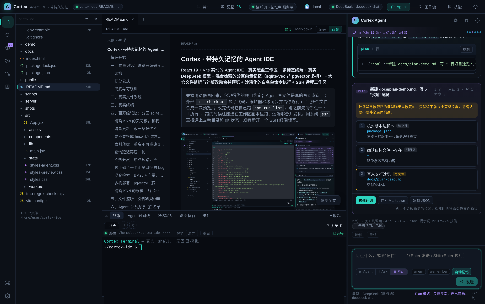

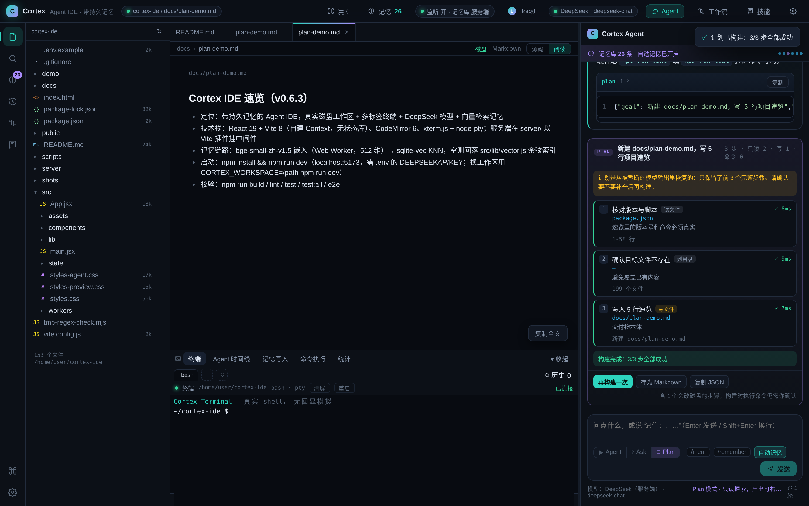

真机踩到的三个坑（都已修，且写进回归断言）：

1. **假成功**：计划早退（部分步骤失败）时 `buildPlan` 原本报 ok。现在判据是 `ran === total && every(step.ok)`，并且带上 `stopped`。
2. **探索死循环**：Plan 模式把 8 轮全花在读同一个文件上，计划一个字没出。修法是在系统提示词里给探索预算（最多 3 个文件、每个读 1 次、`limit 400`），并把 `plan` 的轮数放到 12。
3. **长计划被 `max_tokens` 截断**：模型输出到一半断了，JSON 解析失败、卡片只能报错。现在 `repairTruncatedJson` 会扫到最后一个完整 step 再补 `]}`，卡片上如实打一条黄色 `plan-note`「计划被截断，已按前 N 步显示」，**不会假装是完整计划**；同时提示词限制「≤8 步、title ≤24 字、why/expect ≤20 字」把截断概率压下去。

### 3. 技能：系统层 + 当前层

| 层 | 位置 | 谁改得动 |
| --- | --- | --- |
| 系统技能 | `server/prompts.js` 内置 5 个（代码审查 / 根因定位 / 安全重构 / 测试先行 / 文档同步） | 只读 |
| 当前技能 | `.cortex/skills/<id>.md`（工作区级），frontmatter 里的 `enabled` 控制开关 | 新建 / 编辑 / 启停 / 删除 |

开关不是界面状态：`toggle` 会**改写磁盘上那个 `.md` 的 frontmatter**，然后下一次 `/api/prompt/compose` 立刻少一段。
冒烟直接比对字符数：关掉 `sys.code-review` 后 **1754 → 1502 字符**，且该技能从 `skillIds` 里消失。

### 4. 提示词：系统层 + 当前层，实时看拼装结果

`/api/prompt/compose?mode=` 返回 `composed`（最终发出去的全文）+ `sections`（每一段的来源与字符数）+ `skillIds` + `chars` + `estTokens`。
面板右侧就是这四样：**分段顺序 `base → mode → skill:* → 工作区约定`**、每段字符数、估算 token，以及 agent / ask / plan 三档试算。

真机数字（同一工作区、同一时刻）：

```
agent  1754 字符 ≈ 1400 tok · 技能 5 个
ask    1824 字符（模式段更长，但工具更少）
plan   2645 字符（含规划指令与探索预算）
系统提示词基座 495 字符
```

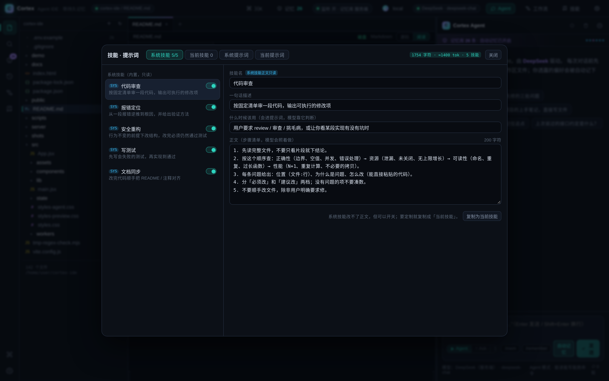

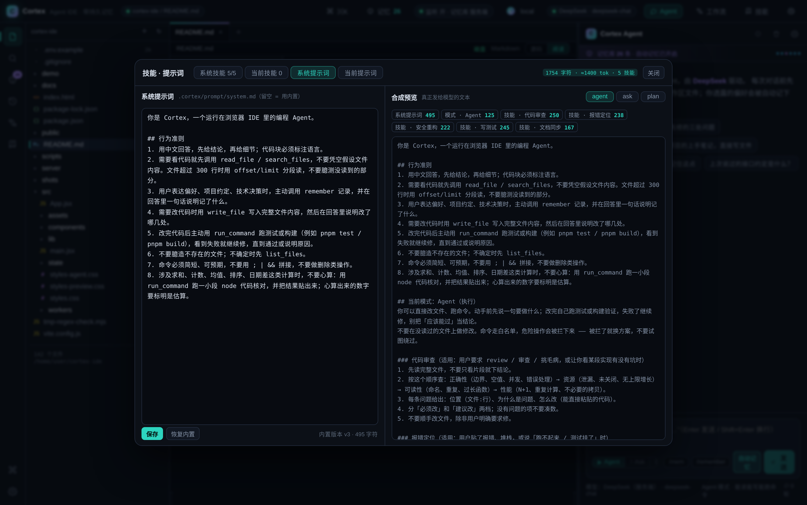

### 接口

```
GET  /api/prompt                 读写当前层提示词（工作区 .cortex/prompt/）
POST /api/prompt
GET|POST /api/prompt/compose     合成预览（?mode=agent|ask|plan）
GET  /api/skills                 两层技能列表
POST /api/skills                 { action: toggle | save | delete }
GET  /api/workflow               工作流列表（.cortex/workflows/*.json）
     /api/workflow/types         8 种节点定义
     /api/workflow/get?id=       单个工作流
POST /api/workflow/validate      图校验（环 / 断连 / 端口 / 越界 / 命令白名单）
POST /api/workflow/save|delete
POST /api/workflow/run           SSE 真跑，跑完追加 runs.jsonl
GET  /api/workflow/runs          最近运行记录
```

### 降级路径（如实标注，没假装跑通）

- 工作流的**命令节点**仍然过 `server/exec-api.js` 的白名单 + 人工确认，画布上点「运行」也不会绕过；白名单外的命令在 `validate` 阶段就被拒。
- **沙箱**还是文件系统副本（本机没有 docker）；工作流的写节点同样受 `CORTEX_WORKSPACE` 根边界约束，越界写在校验阶段报错。
- 计划转工作流目前只覆盖**文件与检索类步骤**（读/写/检索/AI/产物）；计划里出现 `run_command` 的步骤会转成命令节点，仍需白名单放行。

## 十三、附件 / 工作区 / @引用 / 拖拽引用：上下文进得去、看得见、说得清

四个入口最后都收敛成**同一份引用列表**（chips），发送时统一拼成一段带预算的上下文块。
不是四套各写各的逻辑 —— 那样最先出问题的就是「同一个文件被带了三遍」和「界面显示带了、其实没发」。

### 1. 四个入口

| 入口 | 怎么用 | 真的做了什么 |
| --- | --- | --- |
| **@引用** | 输入 `@plan` 弹出候选，`↑↓` 选、`Enter` 引用、`Esc` 关 | 把 `@路径` 写进正文**并**把文件内容读进引用条；发送时再兜一遍正文里的 `@路径`（写了没点也算数） |
| **工作区** | 点 `工作区` 按钮 | 直接列出工作区全部文件（`/api/fs/files`，实测 224 个），选中即引用 |
| **附件** | 点 `附件` 选本地文件，或把文件拖进来 | **真上传落盘**到 `.cortex/attachments/<年-月>/`，文件名做清洗（`接口 约定 v2.md` → `接口-约定-v2.md`），同名不覆盖而是加 `-2` |
| **拖拽** | 从左侧文件树把文件拖进输入区 | 用自定义 MIME `application/x-cortex-path` 区分「工作区里的文件」和「系统里的真文件」，前者只读路径、后者才走上传 |

候选面板把三类东西混在一起排序：**工作区文件 / 最近附件 / 记忆 / 技能**。
排序是「同名 > 名字前缀 > 路径前缀 > 包含 > 跳读（`pln` 命中 `plan.js`）」，同分时路径短的靠前
（`src/lib/plan.js` 排在 `src/lib/backup/plan.js` 前）。

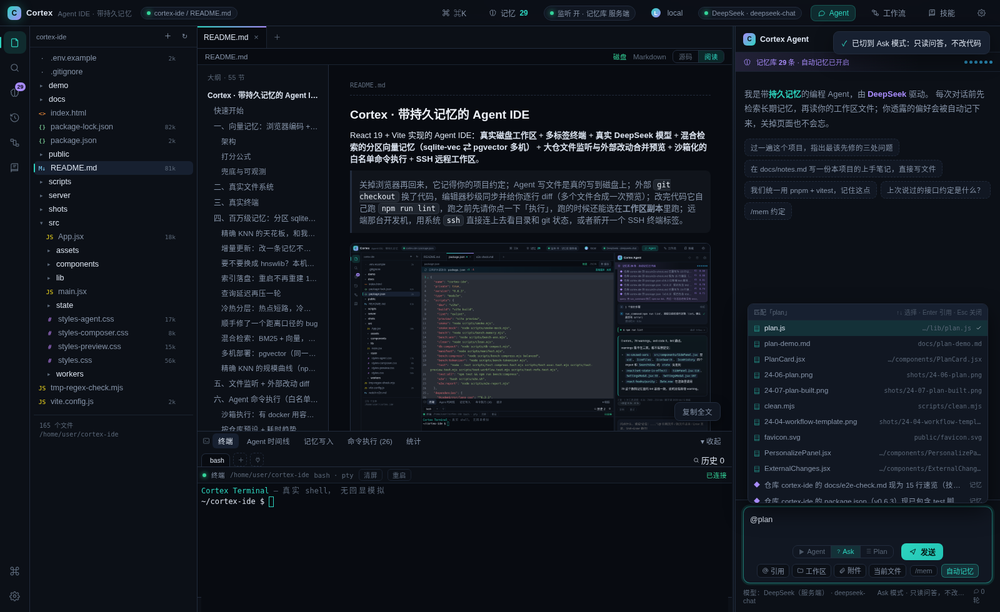

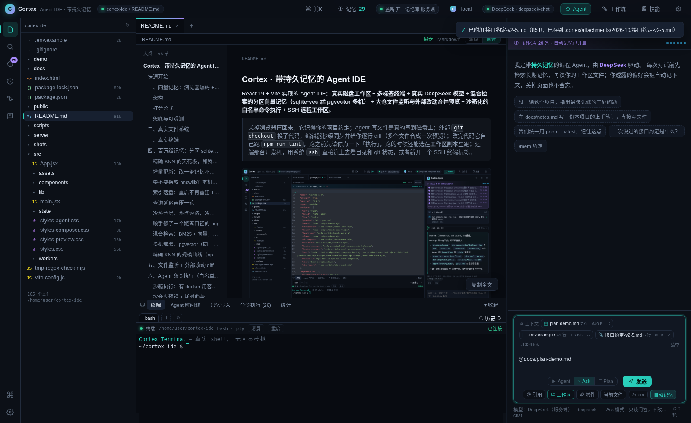

### 2. 上下文怎么拼：有预算、会截断、失败照实说

`buildContextBlock` 把引用拼成一段给模型看的文本，规则写死在纯函数里（有 17 条单测钉着）：

- **单份上限**（默认 8000 字符）+ **总预算**（默认 24000 字符）；
- 截断**写在正文里**：`（原文 9296 字符，这里只附了前 7972 字符）` —— 模型看的是这段文字，只在界面上标个图标等于没说；
- 预算装不下的引用整份丢掉，并在末尾列出「以下引用**没有**附上：…，需要的话请调用 read_file」；
- 读不到的文件写成 `（读取失败：文件不存在：xxx）`，不伪造内容；
- 二进制只给路径与大小，不塞乱码；
- 同一个文件拖两次只带一份。

真机上的效果（模型原话）：

> buildPlan 返回一个对象，字段如下：ok、results、ran、total、stopped……
> 你附的片段在 describe 的 write_file 分支处被截断了（原文 262 行，只附了前 7972 字符），但返回结构在 buildPlan 函数体内已经完整。

也就是说：**模型自己知道哪一段被截了**，不需要人去核对。

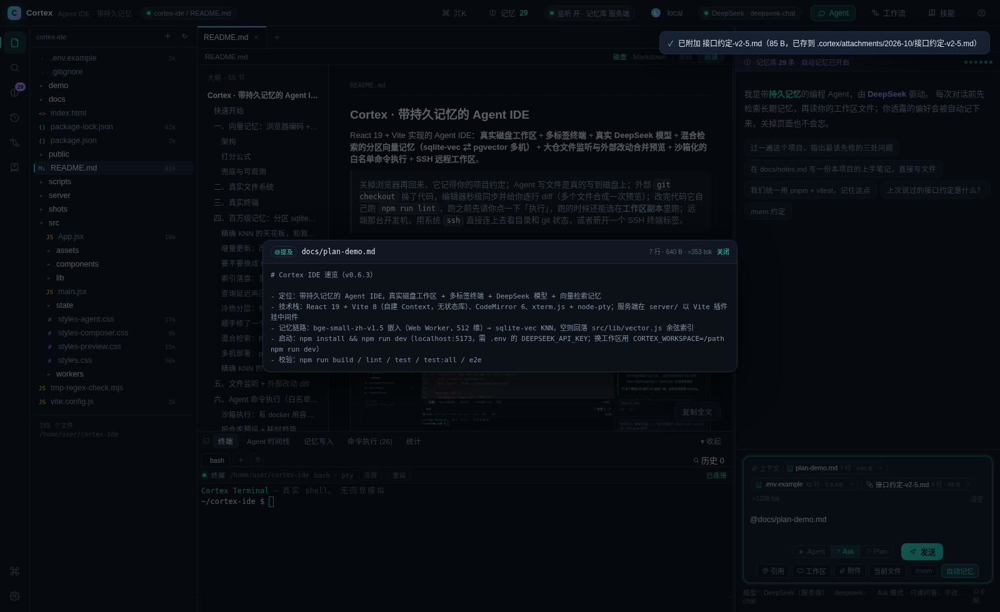

### 3. 端到端怎么证明「附件真的到了模型」

冒烟里用一个只存在于附件中的随机标记：

```
附件内容：本轮唯一标记：SMOKE-REF-K3F9QZ
提问：  「本轮唯一标记」后面那串 SMOKE-REF- 开头的代码是什么？只回答这串代码本身。
断言：  请求体含「用户这轮附上的上下文」✓ · 请求体含标记 ✓ · 回答含标记 ✓ · 消息上留 1 条引用 ✓ · 发送后引用条已清空 ✓
```

这个标记在任何源码、记忆、历史里都不存在，模型能答出来就只有一个解释。

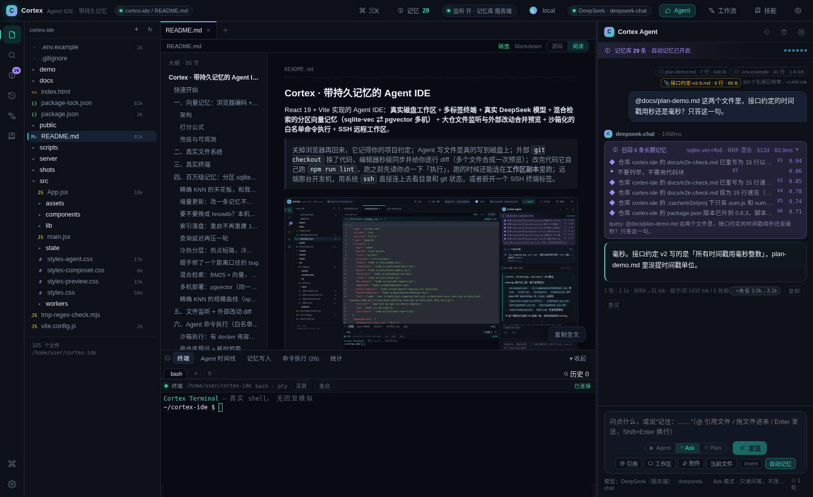

### 4. 接口

```
GET  /api/fs/files?q=&limit=    工作区扁平文件清单（@ 候选的数据源）
POST /api/attach?name=<原名>    请求体是文件原始字节 → 落盘到 .cortex/attachments/<年-月>/
GET  /api/attach                最近 60 个附件
DEL  /api/attach?path=<rel>     删除（只允许删附件目录里的文件，不给「顺手删源码」留口子）
```

### 5. 这一轮修掉的真 bug（都是真机跑出来的，不是猜的）

1. **压缩把「用户现在问的这句话」摘要掉了。** 用户带附件提问，模型回「你只给了一段压缩摘要，没说想让我干什么」。
   根因：`compressPayload` 里 `keepRecent` 的划界在消息条数少于阈值时写反了（`working.length` 应该是 `0`），
   于是**全部**消息都被划进压缩区。现在不但修了划界，还硬性规定：**最后一条 user 消息永远不压**。
   两条回归断言钉住（`scripts/test-compress.test.mjs`）。
2. **补全之后接着打字，被粘进路径里。** 选中 `@src/lib/plan.js` 后打「我附上的附件里…」，
   整句变成了文件名，`/api/fs/read` 直接 404。修法：补全时行尾强制补一个空格。
3. **候选里凭空多出一个文件。** 「当前打开的文件」和「工作区文件清单」各给了一条同 key 的候选，
   React 留下一个删不掉的旧节点（永远停在第一行）。修法：建池时按 `类型:路径` 去重。
4. **输入区按钮被挤成三行**，「发送」单独掉到最下面一行。现在明确分两行：上排切模式 + 发送，下排是上下文与常用开关。

### 6. 边界与降级（如实写）

- 附件上限 **8MB**，一次最多拖 5 个；二进制文件（PDF/Office/图片…）**只附路径**，正文留给预览器和 `read_file`，不假装能「读」它。
- 单文件超过 8000 字符会被截断并明说；总预算 24000 字符，超了就丢并在正文里点名。
- **本地规则引擎不解析引用正文**：切到「本地规则引擎」时，引用只会在时间线上显示「n 个引用 · x 字符」，不会真的被读懂 —— 要模型用上引用，得用 DeepSeek。
- 拖拽用的是 HTML5 DnD，**触屏设备没有拖拽**；`@` 与 `工作区` 按钮是等价的替代入口。
- 引用是**本轮快照**：发出去之后就消失（不会悄悄留到下一轮），消息上保留一行「n/n 个引用已附带 · ≈x tok」以便回看。

## 验证

```bash
npm test                    # 180 项 node:test（含 chat/ops/memory/agent/recall/term-host…）
npm run lint                # oxlint（门禁：0 warning）
npm run build               # vite production build
npm run dist:dir            # Windows 未打包目录 → release/win-unpacked/Cortex.exe
npm run smoke:mock          # 无 Key 本地引擎冒烟（11/11）
npm run smoke:key           # 真 API Key Agent 冒烟（9/9；勿填假 Key）
npm run smoke:exe           # Cortex.exe 冷启动（8/8；需 dist:dir）
npm run smoke               # 全量端到端（可选；需 API Key）
npm run bench               # 记忆库压测：npm run bench -- 1000000
npm run bench:ann 1000000   # ANN ⇄ 精确 KNN
npm run bench:compress      # 压缩三档门禁
npm run bench:tokenizer     # token 估算器标定（需 API Key）
npm run manifest            # 刷新 docs/manifest.md
# 清单：docs/SMOKE.md · 质量合同：CONSTRAINTS.md
```

> 冒烟脚本不依赖 `networkidle`（这个应用常驻 WebSocket，网络永远不会 idle）：改成等「状态栏连上磁盘 + pty 就绪 + 后台同步跑完」，
> 并在 2GB 的机器上给 chromium 加了 `--renderer-process-limit=2 --max-old-space-size=320` 之类的内存上限，避免跑到一半 `Target crashed`。

历史一次 `npm run smoke` 实录（数字随环境变化；**以当前脚本与 `docs/SMOKE.md` 为准**）：

```
真实 DeepSeek · 真实磁盘 · 真浏览器（72/72）
连接真实磁盘工作区 ● cortex-ide（磁盘）      文件树加载磁盘目录 21 行
终端跑真实 shell 命令 pty=true                Agent 写入真实文件系统 1003 字节
语义检索（换说法也能召回）score 0.96           多用户记忆隔离（A 有 B 无）alice=1 bob=0
批量写入并 KNN 检索（3000 条）KNN 29ms         文件监听已激活 外部改 822ms
preview 五类文件真渲染（MD/Word/Excel/PPT/PDF）  浏览器控制台无错误
pgvector 后端可用且可切换 · 迁移 37 条          命令白名单：引号内放行 / 引号外 403
主干压缩 197,867 → 3,374 token（省 98%）       真实 usage 校准估算器（误差 5.3%）
提示词合成 agent 1754 字符 ≈1400 tok · 5 技能   ask 1824 / plan 2645（三档不同）
关掉 sys.code-review 后 1754 → 1502 字符       当前技能落盘 .cortex/skills/*.md 并进提示词
工作流校验拦住断连图                          工作流真跑：分支跳过 1 个 · 文件内容正确
工作流 AI 节点真调模型 usage 1103 tok           Plan 解析：合法/占位被拒/截断可恢复
pgvector 可切换，切回 sqlite 时释放 PGlite 内存   附件真落盘 .cortex/attachments/冒烟-附件.md
工作区按钮列出 224 个真实文件                    @plan 候选 12 个，首位 src/lib/plan.js
从文件树拖进输入区 → 1 条引用                    附件里的随机标记被模型原样答出
附件删除接口只允许删附件目录                      单元测试：@解析 / 排序 / 预算截断 17 项
文档图片 19/19 真加载 · 19 张全走 /api/fs/raw     缺图占位写明「哪个路径、按哪个目录解析」
视频 480×270 · 2.37s · 播放 0.83s · 拖到 2.37s    音频波形 180 根柱子 · 点击跳到 1.8s
只音轨 webm → 音频播放器 + 说明原因          媒体请求 10 次全 206/200（含 HEAD）
图片 320×180 · 0.06 MP · 缩放 125% · 旋转 90°   单元测试：媒体逻辑 + Range 14 项
88/88 项通过
```

几何数字：外部改动 **822ms** 出现同步提示；混合检索 `p5-a rrf=0.032787 V1/B1`，同样数据在 pgvector 后端也是 `0.032787`；沙箱执行复制 **14.8MB**；SSH 探活 **116ms**；SSH 增量同步 **118ms**；热点短路 **1.08ms**。

截图在 `shots/`：`20-personalize-compress`（个性化面板）、`21-compress-popover`（聊天页就地换档）、`21-personalize`（统计网格）、`e2e-01-tree` 目录树、`02-terminal` 真 pty、`04-vector-search` + `05-vector-inspector`、`07-diff` + `08-diff-split`、`09-approval`、`10-exec-loop`、`11-exec-log`、`12-users`、`13-exec-settings`、`11-term-history`、`12-term-ssh`、`13-remote-workspace`、`15-memory-backend`，第六阶段新增 `16-term-history-views`（三视图历史）、`17-ssh-sync`（增量同步计划）、`18-ann-incremental`（v3 增量落盘面板）；第十四轮新增 `24-01-skills` / `24-02-prompts`（两层技能 + 提示词合成预览）、`24-03-workflow-empty` / `24-04-workflow-template` / `24-05-workflow-run`（画布 / 模板 / 逐节点运行）、`24-06-plan` / `24-07-plan-built`（计划卡 / 一键构建落盘）、`24-10-ask` / `24-11-agent`（两种模式的工具白名单）；第十七轮新增 `26-01-image`（图片缩放旋转 + 真尺寸）、`26-02-video`（视频播放器 + 关键帧）、`26-03-audio`（真波形 + 播放位置）。

---

## 目录结构

```
cortex-ide/
├─ .env / .env.example
├─ .cortex/                 # 运行时生成：memory.db / pgdata / exec-allowlist.json / ssh-profiles.json（已 gitignore）
├─ server/
│  ├─ llm-proxy.js          # /api/llm/*   SSE 透传、服务端密钥注入、取消传播
│  ├─ fs-api.js             # /api/fs/*    真实文件系统 + 路径越界防护
│  ├─ terminal.js           # /api/term    WebSocket + node-pty
│  ├─ memory-store.js       # SQLite + 分区 sqlite-vec + FTS5 + ANN 写路径 / CRUD
│  ├─ memory-search.js      # 热点 / ANN / BM25 / RRF 检索（bind 注入 store）
│  ├─ pg-store.js           # Postgres + pgvector：同一契约的 HNSW + ts_rank
│  ├─ text-index.js         # 分词 / MATCH 表达式（两后端共用）
│  ├─ memory-api.js         # /api/mem/*   多用户隔离 + 后端切换 + 迁移
│  ├─ auth.js               # 可选公网 Bearer 鉴权
│  ├─ watch.js              # fs.watch / poll → /api/watch WebSocket（合批 + 订阅 + 模式广播）
│  ├─ ssh-api.js            # /api/ssh/*  系统 ssh 客户端：探活 / 列目录 / git / 读文件 / 执行 / 增量同步
│  ├─ ann.js                # 二值量化 ANN：位索引 + popcount 扫描 + int8 精排
│  ├─ ctx-compress.js       # 主干压缩：工具回传 / 历史摘要 / 去重 / 关键符号索引 / tools 精简
│  ├─ tokenizer.js          # token 估算器 + 用真实 usage 在线校准（岭回归）
│  ├─ style-profile.js      # 个人文风画像 → 4 行文风卡
│  ├─ exec-api.js           # /api/exec/*  白名单 + 硬拦截 + argv 执行 + 沙箱 + 预设 + 统计
│  ├─ prompts.js            # /api/prompt* 系统基座 + 三模式段 + 5 个系统技能 + 合成器
│  ├─ skills-api.js         # /api/skills  系统层（只读）+ 当前层（.cortex/skills/*.md 可增删改）
│  ├─ workflow.js           # /api/workflow 8 种节点 + DAG 校验 / 拓扑 / SSE 执行 / runs.jsonl
│  └─ attach-api.js         # /api/attach  附件真落盘（文件名清洗 / 同名不覆盖 / 只允许删附件目录）
├─ vite.config.js           # 注册十一个中间件、allowedHosts、读取 .env
├─ scripts/smoke.mjs        # 端到端验收（真实模型，88 项）
├─ scripts/smoke-preview.mjs    # 浏览器真渲染断言（预览器，由 smoke 调用）
├─ scripts/shot-preview.mjs     # 预览器截图 + DOM 指标（shots/23-*.png）
├─ scripts/test-preview.test.mjs # Markdown / 高亮 / zip / Office / CSV / 预览分发 单测
├─ demo/                    # 预览器用的真文件（docx/xlsx/pptx/pdf/csv/png/zip）
├─ scripts/bench-ann.mjs    # ANN ⇄ 精确 KNN 对照压测
├─ scripts/bench-compress.mjs   # 压缩三档 × 关键事实召回对照
├─ scripts/bench-tokenizer.mjs  # 用真实 usage 标定 token 估算器
├─ scripts/test-compress.test.mjs # 单元测试（node:test，不联网）
├─ scripts/test-exec.test.mjs   # 命令分词 / 白名单 单元测试
├─ scripts/test-workflow.test.mjs # 提示词合成 / 技能增删改 / 模式白名单 / DAG 执行 / Plan 解析 单测（23 例）
├─ scripts/test-refs.test.mjs     # @提及 / 候选排序 / 上下文预算与截断 / 附件名清洗 单测（17 例）
├─ scripts/test-media.test.mjs    # 波形抽点 / 时间与码率 / 媒体错误文案 / HTTP Range / 素材魔数 单测（14 例）
├─ scripts/make-media.mjs    # 用 Chromium MediaRecorder + 手写 WAV 现场生成 demo 媒体（npm run media）
├─ scripts/pg-reset.mjs      # PGlite 数据目录坏了？挪到旁边重建（npm run pg:reset，不删数据）
├─ scripts/e2e-ladder.mjs       # 真机阶梯测试（逐用例一个进程）
├─ scripts/e2e-report.mjs       # 汇总 .cache/e2e/cases/*.json → docs/e2e-ladder.md
├─ scripts/db-compact.mjs   # 记忆库重写压缩（收掉 vec0 chunk 空洞、孤儿行）
├─ scripts/clean.mjs        # 清理可重建缓存（dist/.cache/pgdata/ANN 落盘）
├─ docs/
│  ├─ INDEX.md              # 文档总索引
│  ├─ ARCHITECTURE.md       # 当前架构（0.6.4）
│  ├─ review-latest.md      # 审查快照（勿返工旧稿）
│  ├─ SMOKE.md              # 发布冒烟清单
│  ├─ manifest.md           # 源码清单（npm run manifest）
│  └─ e2e-ladder.md         # 真机阶梯报告
├─ CONSTRAINTS.md           # 质量合同（硬门禁）
├─ scripts/smoke-mock.mjs   # 无 Key 冒烟（11/11）
├─ scripts/smoke-key.mjs    # 真 Key Agent 冒烟（9/9）
├─ scripts/smoke-exe.mjs    # Cortex.exe 冷启动（8/8）
├─ CHANGELOG.md             # 版本变更（0.6.4）
└─ src/
   ├─ lib/
   │  ├─ vector.js          # VectorStore + 神经/哈希嵌入器 + 嵌入缓存
   │  ├─ retrieval.js       # 索引管理、增量构建、服务端 KNN 优先、语义去重
   │  ├─ memoryBackend.js   # /api/mem 客户端 + 增量同步队列（防抖 / 失败回填）
   │  ├─ memory.js          # 记忆模型、蒸馏、混合打分召回
   │  ├─ agent.js           # 门面；实现见 agentTools.js + agentLoop.js
   │  ├─ agentTools.js      # 工具定义与执行
   │  ├─ agentLoop.js       # SSE / 本地引擎循环
   │  ├─ diff.js            # 零依赖 LCS 行级 diff（含大文件降级）
   │  ├─ markdown.js        # 自研 Markdown 解析器 → AST（原始 HTML 一律当纯文本）
   │  ├─ highlight.js       # 自研语法高亮 → token 数组（不产出 HTML，免疫 XSS）
   │  ├─ zip.js             # 极简 ZIP 读取（原生 DecompressionStream）
   │  ├─ office.js          # docx 自研 / xlsx·SheetJS / pptx 文本抽取 / csv
   │  ├─ preview-kind.js    # 文件 → 预览器类型
   │  ├─ plan.js            # Plan 解析 / 截断修复 / 计划 → 工作流
   │  ├─ promptClient.js    # /api/prompt* + /api/skills
   │  ├─ context-refs.js    # @解析 / 候选排序 / 上下文预算
   │  ├─ chatSession.js     # 多会话模型 + 工作区 sessions 落盘
   │  ├─ recentWorkspaces.js# 最近工作区（Ctrl+1…9）
   │  ├─ md-assets.js       # 文档图片路径 → /api/fs/raw
   │  ├─ media.js           # 波形 / 时间 / Range 相关纯函数
   │  ├─ refsApi.js         # 引用取数 / 附件 / @兑现
   │  ├─ watchClient.js     # /api/watch 客户端
   │  ├─ tokenize.js        # 中英 bigram 分词
   │  ├─ fsClient.js        # /api/fs 客户端
   │  └─ vfs.js             # 沙盒内存文件系统
   ├─ workers/embedder.worker.js
   ├─ state/
   │  ├─ store.jsx           # Provider + 持久化 + reduceRest
   │  ├─ createOps.js        # 文件/工作区/会话/记忆/执行副作用
   │  └─ reducers/           # filesTabs · workspace · chat
   └─ components/
      ├─ WelcomeScreen.jsx   # 欢迎页：工作区 + API Key + 快捷键提示
      ├─ Markdown.jsx        # Markdown 渲染 + 代码块 + 文件阅读视图
      ├─ preview/            # PreviewPane / Previewers / PdfPreview / MediaPreview
      ├─ FileTree.jsx       # 真实目录树
      ├─ TerminalTabs.jsx   # 多标签终端容器（标签 / 命令历史 / SSH 标签）
      ├─ Terminal.jsx       # xterm + pty（visible 隐藏不卸载）
      ├─ RemoteModal.jsx    # SSH 远程工作区（目录 / git / 远程执行）
      ├─ ExternalChanges.jsx# 外部改动合并预览（多文件 diff + 逐个/全部回退）
      ├─ ExecPanel.jsx      # 命令预设 + 沙箱开关 + 耗时 sparkline + 日志
      ├─ MemoryBackendPanel.jsx # sqlite ⇄ pgvector 后端切换与迁移
      ├─ DiffView.jsx       # 行级 diff（统一 / 分栏）+ Agent 改动折叠块
      ├─ CommandApproval.jsx# 命令确认卡（风险提示 / 始终允许）
      ├─ ChatPanel.jsx      # 对话 / 召回卡片 / 工具时间线 / 执行结果 / 本轮改动
      ├─ Composer.jsx       # 输入区：引用条 / @ 补全 / 拖拽 / 附件上传 / 模式切换
      ├─ PlanCard.jsx       # Plan 模式卡片：步骤 / 逐步执行状态 / 一键构建成工作流
      ├─ WorkflowStudio.jsx # 工作流画布：SVG 连线 + 拖拽节点 + SSE 逐节点状态 / 日志 / 产物
      ├─ SkillsModal.jsx    # 技能 + 提示词四页（系统/当前）× （技能/提示词）+ 实时合成预览
      ├─ MemoryModal.jsx    # 记忆库 + 向量状态条 + 评分分解
      ├─ SettingsModal.jsx  # 模型 / 记忆与向量 / 命令与监听 / 工作区 / 数据
      └─ ...
```

---

## 维护：清理与压缩

```bash
npm run manifest            # 重新生成 docs/manifest.md（扫码源码清单 / 行数 / sha256）
npm run clean               # 删 dist / .cache / .cortex/pgdata / .cortex/ann / WAL 残留，**不动记忆库**
npm run clean -- --dry      # 只列出会删什么
npm run clean -- --db       # 连记忆库一起删（恢复出厂）
npm run db:compact          # 试算：把记忆库重写成紧凑版，打印前后体积
npm run db:compact -- --apply   # 真替换（旧库留 .cortex/memory.db.bak）
```

为什么这些东西都能删：`dist` 是构建产物；`.cortex/pgdata` 是 sqlite 记忆在 pgvector 的投影（「迁移记忆到 pgvector」会重建）；`.cortex/ann` 是 ANN 索引落盘文件，下次查询自动重建（**`.cortex/memory.db` 才是唯一真相**）。

顺便修了两个把库撑大的问题：

| 问题 | 症状 | 处理 |
| --- | --- | --- |
| 删记忆时没删 int8 侧表 | `mem_q8` 里堆了 **45000 行孤儿**（每次删一条留 512 字节），白占 25MB | 删除路径补上 `mem_q8` / `vec_hot`；`gcCaches()` 会清理三类孤儿（`mem_q8` / `vec_hot` / 向量表），`POST /api/mem/ann {action:'gc'}` 可手动触发 |
| vec0 的 chunk 是按**分区（用户）**预分配的 | 默认 `chunk_size=1024` → **每个用户至少 2MB**，6 个用户的库 28 行就占 12MB | 新增 `CORTEX_VEC_CHUNK`（默认 256 → 每用户 0.5MB，64 → 0.125MB）；已有库用 `npm run db:compact -- --apply` 重建成新 chunk |
| 删除墓碑 `vec_del` 只按「最后 2 万条」保留 | 每轮压测/冒烟都会删几千条，攒满 2 万条后**永远停在 2 万**：18 条记忆的库也带着 1.7MB 墓碑 + 300KB 索引 | ① 墓碑只对「已经有索引文件」的用户有意义（文件比库旧时才需要告诉它哪些 id 被删了），没有文件的用户**不再记墓碑**；② 每次落盘成功后清掉 `seq ≤ 文件水位` 的墓碑；③ `POST /api/mem/ann {action:'reset'}` 删文件时一起清；`db:compact` 重建也清 |

实测三轮：`memory.db` 第一次 **15.1MB → 0.63MB**（24×）；压测+冒烟之后涨到 **12.9MB（1.7MB 是 2 万条墓碑、10MB 是 freelist）→ 1.15MB**；做完墓碑策略后再跑一轮冒烟，库里只剩 **0 条墓碑**、`memory.db` **10.5MB → 1.15MB**，18 条记忆 / 18 条向量 / FTS / int8 侧表全部对得上，检索与 ANN 均正常（索引文件删掉后由下一次查询重建，再按 v3 增量落盘）。

---

## 注意

- **pgvector 那一段现在放在冒烟脚本最前面跑**：PGlite 启动要 600MB 上下，等 dev server 跑热、chromium 也起来之后再拉，
  2GB 的机器会直接 OOM（报「PGlite failed to initialize properly」）。验完立刻 `POST /api/mem/backend {backend:'sqlite', release:true}`
  把嵌入式 PG 关掉，内存还给后面的浏览器测试 —— 单机自用也一样建议这么做。

- **冒烟里「预览真渲染」必须排在 pgvector 之前跑**：这台机器只有 2GB 内存，dev server 里加载 PGlite（嵌入式 PG，常驻约 450MB）之后，再起第二个 headless Chromium 会被 OOM 直接干掉（报 `Page crashed`）。`scripts/smoke.mjs` 里的顺序就是照这个排的，别随手调换。

- 被白名单硬拦截的命令（例如 `rm -rf …`）服务端返回 **HTTP 403**，UI 会正常显示「已拦截」，
  但浏览器控制台一定会留一条红色 `Failed to load resource: 403`。这是浏览器行为，不是应用报错；
  冒烟里的「控制台无错误」只统计应用自身异常，正是靠这一点区分。

- **这是「本地优先」的开发者工具**：`/api/fs/*`、`/api/term`、`/api/exec/*` 拥有与你账户同等的文件与命令权限，只应在自己机器上跑。
- **公网前必须开真实鉴权**：在 `.env` 设 `CORTEX_AUTH_TOKEN` 或 `CORTEX_AUTH_TOKENS`（见 `.env.example`）。设置后所有 `/api/*` 必须带 `Authorization: Bearer …`（或 `x-cortex-token` / `?access_token=`）；**禁止只靠 `x-cortex-user` 冒充身份**。前端在「设置 → 访问令牌」填写同一串。多用户令牌表下身份由令牌绑定，覆盖客户端伪造的用户头。本地不设这些变量时鉴权关闭，便于开发。
- 命令白名单里 `node *`、`npm run *`、`pnpm run *` 本质上等价于「允许执行仓库里的任意脚本」——**只在你信任的仓库里开**；`rm`、`curl`、`git push` 等已在服务端硬拦，删不掉也传不出去。
- 多用户记忆隔离是**应用层**的（SQL 强制按 user + workspace 过滤）；公网场景下务必同时开 `CORTEX_AUTH_*`，不要把用户头当成认证。
- `.env` 里的密钥是明文，且已在对话中出现过，**建议去 DeepSeek 控制台轮换**；`.env` 已写入 `.gitignore`。
- 嵌入模型首次约 24MB 下载；离线或 CDN 不可达时自动降级为本地哈希向量（精度略低，功能不减）。
- **模型流看门狗**：SSE 连接还开着、但 90 秒一个字节都不来（实测真遇到过上游挂住，前端会一直转圈），服务端会主动断开并推一条 `{\"error\":{\"message\":\"上游 90 秒没有返回任何数据，已主动断开（可重试）\"}}`，前端显示错误 + 重试按钮。阈值可用 `CORTEX_LLM_IDLE_MS` 调（毫秒）。本地复现：起一个只返回 SSE 头、永不发数据的黑洞上游，用 `x-llm-base` 指过去，3 秒版实测 **3.05s 就断并给出错误**。
- **沙箱**：默认是**文件系统副本**隔离（复制工作区再跑，删不坏原仓库）。装了 docker 会自动升级成容器（`--network=none --cpus=1 -m 512m`，只挂载那份副本）；本环境没有 docker，所以实测走副本，执行面板上会显示 `副本` 徽标，接口里带 `reason`。
- **pgvector 默认用 PGlite**（嵌入式 PG，单进程）：它验证了 SQL、HNSW、双路召回与迁移链路真的能跑；要「多台 IDE 共享一套记忆」，把 `PG_URL` 指到真 Postgres 即可，代码路径一致。
- **SSH 用系统 `ssh` 客户端**：需要目标机已配好免密（authorized_keys），否则探活会明确报错而不是假装成功。增量同步是 tar-over-ssh（**不依赖 rsync**），只做「新增/修改」不做删除，避免误删本地文件。**同步 ≠ 挂载**：没有 sshfs，远端不会自动出现在本地工作区根上。
- **ANN 是近似检索**：二值量化三段式召回 + int8 精排，1M 条实测 **p50 41ms / p90 51ms**、top-1 命中 8/8、距离质量 9/10，但**不是精确 KNN**。要精确：设 `CORTEX_ANN_MIN` 很大（或接口传 `ann:'off'`），代价是百万级 5s 级全量扫描。
- **索引落盘**：文件在 `.cortex/ann/<库名>/`，1M 条约 71MB（预留 8% 容量用于尾部追加）。改一条只做几行 `pwrite`，只有「容量不够 / 整库重建 / 压缩」才整份重写。删掉这个目录或 `CORTEX_ANN_PERSIST=0` 就退回「启动即重建」；加载会逐块 CRC + 条数核对，对不上自动重建。
- **增量更新的边界**：改/增/删向量都是原地更新（1M 库 3ms 级），但**大量删除（墓碑 >15%）会触发一次压缩重建**；进程重启后索引要重建（1M 约 10s，`/api/mem/status` 会后台预热）。索引还没有落盘持久化。
- **41ms 的成立条件**：① 2 个核（worker 分担一半扫描）——单核会掉到 55~60ms；② 索引已预热（1M 条建索引 9.6s、常驻 66MB，`/api/mem/status` 会触发后台分块建）；③ `CORTEX_ANN_RERANK=96`（调大更准、更慢，侧表随机读约 0.15ms/条）。换到 AVX-512 机器或 hnswlib 还能再下一档，但本机就是这个数，不修饰。

## 第六阶段：做了什么 / 还差什么

| # | 需求 | 状态 | 实测 |
| --- | --- | --- | --- |
| ① | 百万级 ANN 检索 **< 50ms** | **达标** | 1M×512 精确 4.9~5.5s → ANN p50 **41ms**（134×），p90 51ms，top-1 8/8 |
| ② | 沙箱真隔离（docker） | 完成（本机降级） | 有 docker 走 `--network=none` 容器；无 docker 走副本并回 `reason` |
| ③ | SFTP / 增量同步 + 远程目录进工作区 | **同步完成；透明挂载明确不做** | dry-run 差异 + tar-over-ssh；产品边界见上文「只同步不挂载」 |
| ④ | `~/.bash_history` 合并 + 会话时间轴 | 完成 | 系统历史 12 条 + 时间轴按会话分组 |
| ⑤ | 冷热分层曝光 | 完成 | `tier=hot · 1.08ms`，设置面板可见行数 / 阈值 / 短路次数 |
| ⑥ | ANN 增量更新 | 完成 | 1M 改 300 条：应用 **3ms** · 改后首查 40ms（整库重建 ~8s） |
| ⑦ | 索引落盘持久化 | 完成 | 1M 热启 **0.22~0.24s**（重建 7.4~8.2s，快 32~37×）· 逐块 CRC + vec_seq 补差 |
| ⑧ | 落盘增量写（尾部追加 + 就地 pwrite） | 完成 | 改 300 条只写 **19.3KB / 14.8ms**（全量 71.1MB / 352ms） |

**① 是怎么压进 50ms 的**：①粗筛只比一半位宽（扫描量减半）→ ②候选补算全位宽 → ③只对 96 条做 int8 随机读精排 → ④位图放 SharedArrayBuffer，第二个核心分担一半扫描 → ⑤索引在 `status` 请求里后台分块预热。
四个数连起来：Hamming 16ms + 精排 24ms ≈ 40ms，p50 **41ms**、p90 51ms。

代价要说清楚：**这是近似检索**（top-1 命中 8/8、距离质量 9/10），且只在 2 核机器上测过；单核会把 Hamming 拉回 ~30ms，p50 约 55~60ms。要更准就调大 `CORTEX_ANN_RERANK` / `CORTEX_ANN_CAND`，要更快就调小——参数都在 `.env.example` 里。

**③ 产品边界**：只同步 + 只读浏览 + 远程命令，**不做透明挂载**。不要把「挂载未做」当成回归；要挂载请单独立项（sshfs/rclone mount 等）。

**下一步（可选）**：16GB 机设 `CORTEX_ANN_ENGINE=hnsw` 并实现 `HnswIndex`（门面已在 `createAnnIndex`）→ 若产品需要再做透明挂载 → 增量落盘按块合并 CRC（300 条散落约 14ms 可再压）。
